# Array Backend Architecture in PySATL Core

This document combines the key findings from the current PySATL Core implementation research with the proposed architecture. It retains only the facts that affect the architectural decision.

The research is based on commit [`37f7679`](https://github.com/PySATL/pysatl-core/tree/37f767964350569b354df4efcb552d0b2d9a3fb6).

## Terminology

- **Backend** — the root object of the selected computation implementation.
- **Array backend** — the set of interfaces for creating, validating, and processing scalars and arrays.
- **Array validator** — the component that inspects native values and validates them against method contracts.
- **Array package** — the `pysatl_core.arrays` functions used by formulas and characteristic conversions.
- **Native value** — a scalar or array in the active backend representation, without a shared PySATL wrapper.
- **Normalization** — a one-time conversion of a public input into a native value.
- **Data type** — the native `dtype` representation managed by the backend.
- **Device** — the execution and storage location fixed for the process.
- **Capability** — a supported combination of operation, data type, and device.
- **Default backend** — the implementation created on the first computation when no backend was initialized explicitly.
- **Contract test** — the same behavioral test executed against every interface implementation.

## Research summary

The current code uses NumPy and SciPy as the data representation, the mathematical operation set, and the implementation of individual algorithms. Direct imports of these libraries appear in 33 of the 78 Python files in the package.

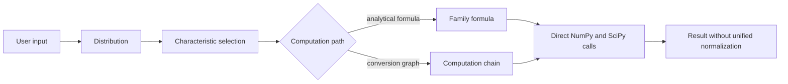

### Current public call

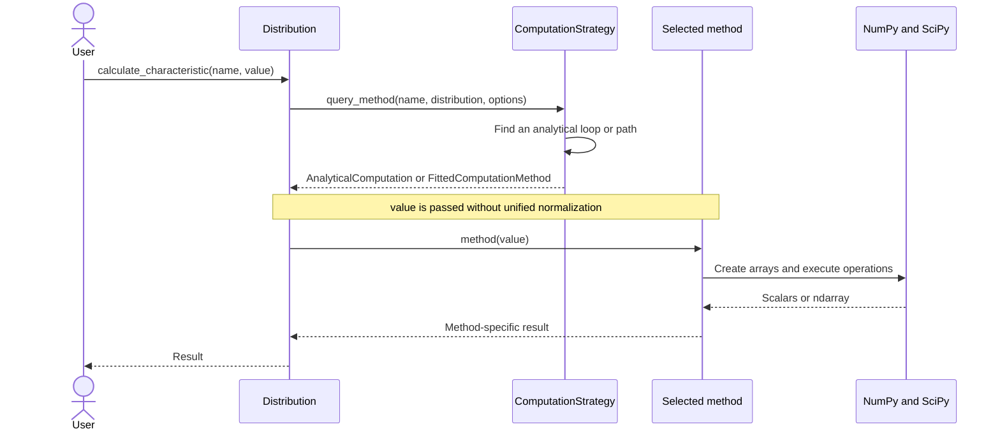

`Distribution` selects a method through the strategy and immediately passes the user value to it. The input type and result shape depend on the selected method.

### Current graph path

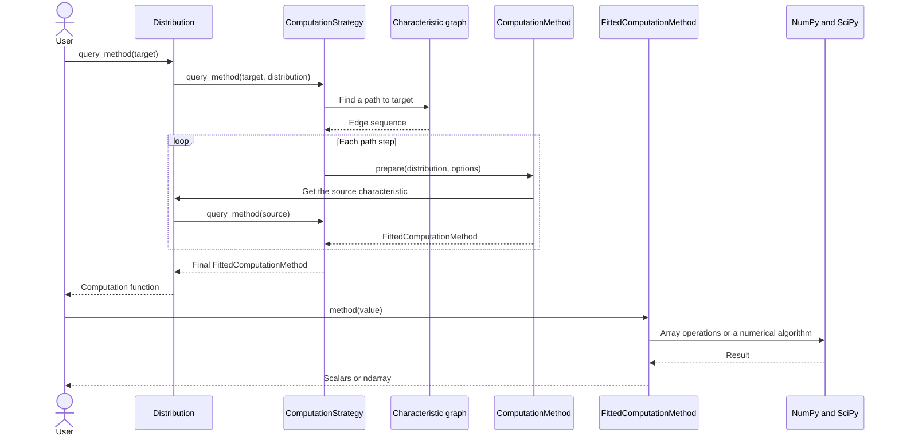

The public `query_method` returns the computation callable directly. Internal steps obtain other characteristics through the same public path, while concrete libraries execute the operations.

### Library dependencies

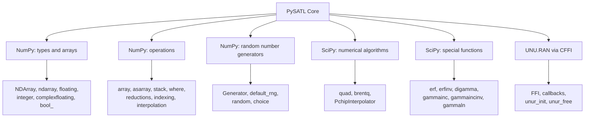

NumPy defines the data types, stores values, and performs most operations. SciPy provides algorithms and special functions. UNU.RAN uses a separate CFFI boundary and CPU scalars.

| Library | Used entities | Usage |
|---|---|---|
| NumPy: types and computation control | `NDArray`, `ndarray`, `floating`, `integer`, `complexfloating`, `bool_`, `float64`, `intp`, `inf`, `nan`, `pi`, `errstate` | Public aliases, typing, constants, and numerical warning handling |
| NumPy: creation and shape | `array`, `asarray`, `atleast_1d`, `empty`, `zeros`, `full_like`, `arange`, `linspace`, `fromiter`, `stack`, `concatenate` | Formulas, characteristic conversions, grids, tables, and samples |
| NumPy: mathematics | `exp`, `log`, `log1p`, `sqrt`, `power`, `sinc`, `clip`, `where`, `minimum`, `maximum` | Analytical formulas and distribution transformations |
| NumPy: reductions and indexing | `sum`, `min`, `max`, `argmax`, `cumsum`, `diff`, `argsort`, `searchsorted`, `nonzero`, `unique`, `add.at`, `maximum.accumulate` | Discrete tables, masks, sorting, and probability accumulation |
| NumPy: checks | `isfinite`, `isnan`, `isinf`, `isclose`, `nan_to_num` | Parameter, boundary, and approximation result validation |
| NumPy: randomness | `Generator`, `default_rng`, `random`, `choice` | Inverse sampling, mixtures, and the UNU.RAN URNG |
| SciPy: algorithms | `quad`, `brentq`, `PchipInterpolator` | Integration, characteristic inversion, and monotone interpolation |
| SciPy: special functions | `erf`, `erfinv`, `digamma`, `gammainc`, `gammaincinv`, `gammaln` | Normal and Gamma families |
| CFFI and UNU.RAN | `FFI`, `ffi.callback`, `unur_init`, `unur_free`, `unur_distr_*` | `DefaultUnuranSampler`, `UnuranSamplerInitializer`, `UnuranCallback`, `DGTSetup` |

Approximation classes also depend on library-specific implementations: `CDFMonotoneSplineApproximation` and `PPFMonotoneSplineApproximation` use `PchipInterpolator`, while `PDFLinearInterpolationApproximation` uses `numpy.interp`.

### Current data types

The public aliases in `types.py` are defined directly through NumPy:

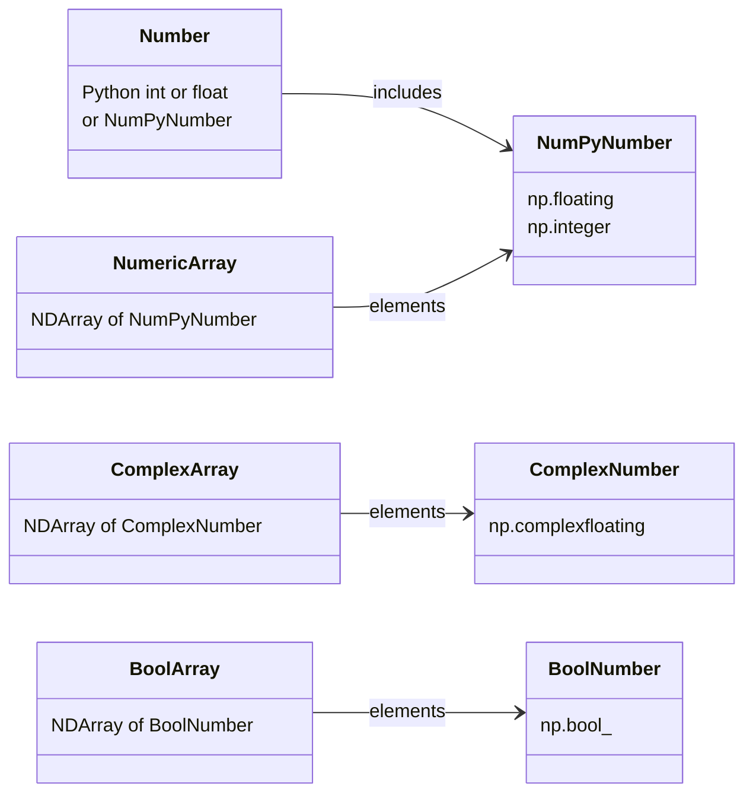

| Type | Current definition | Usage |
|---|---|---|
| `Number` | Python `int`, `float`, or `NumPyNumber` | Parameters and scalar boundaries |
| `NumPyNumber` | `np.floating` or `np.integer` | Element type of a real-valued numerical array |
| `NumericArray` | `NDArray[NumPyNumber]` | PDF, CDF, PPF, PMF, grids, and samples |
| `ComplexArray` | `NDArray[np.complexfloating]` | Characteristic functions |
| `BoolArray` | `NDArray[np.bool_]` | Supports, checks, and masks |
| Index arrays | Usually `np.intp` | Sorting, search, and element selection |

Most computation paths explicitly convert real-valued data to `float64` and complex results to `complex128`. Masks use `bool`, while indices use `intp`. The code also uses Python scalars, NumPy scalars, and zero-dimensional arrays without a unified public contract.

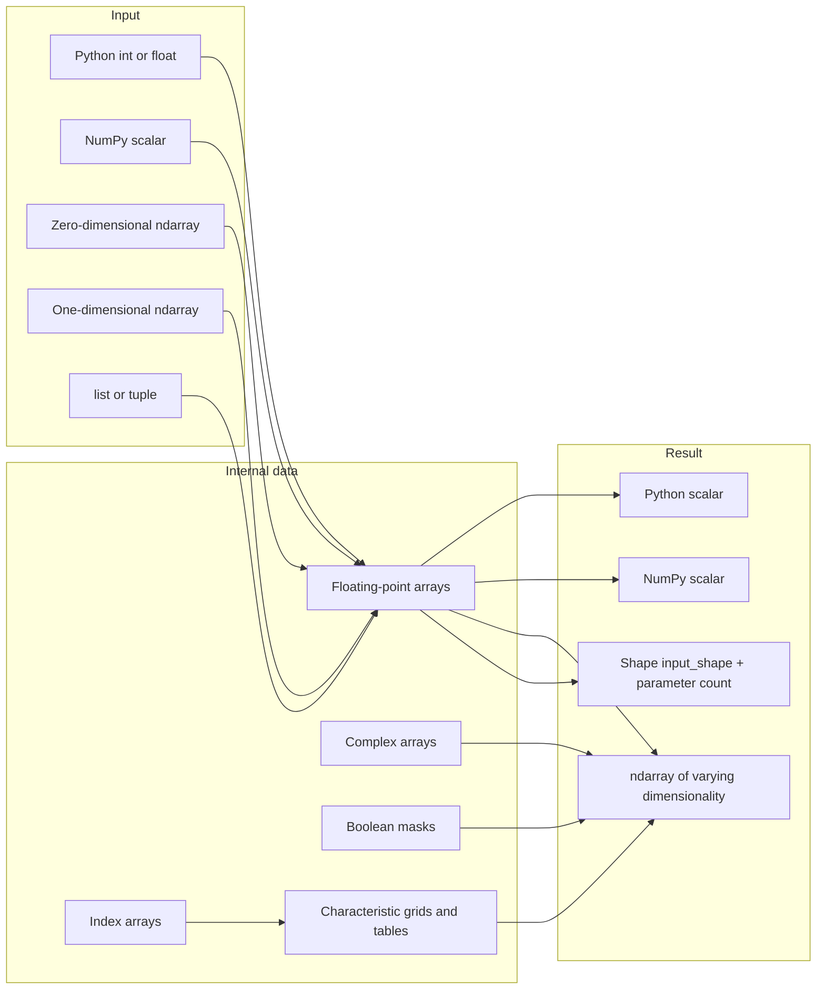

The selected path determines the result shape. An analytical formula may return a scalar, while a graph conversion may return an array with shape `(1,)`. Gradients add a parameter axis, Boolean checks return masks, and samples usually have shape `(n,)`.

Key locations in the current implementation:

| Area | Current code | Architectural impact |
|---|---|---|
| Public computation | [`distribution.py`](https://github.com/PySATL/pysatl-core/blob/37f767964350569b354df4efcb552d0b2d9a3fb6/src/pysatl_core/distributions/distribution.py#L352-L389) | Input normalization must start here |
| Method selection | [`strategies.py`](https://github.com/PySATL/pysatl-core/blob/37f767964350569b354df4efcb552d0b2d9a3fb6/src/pysatl_core/distributions/strategies.py#L656-L794) | The public method must return a contract-enforcing wrapper |
| Public types | [`types.py`](https://github.com/PySATL/pysatl-core/blob/37f767964350569b354df4efcb552d0b2d9a3fb6/src/pysatl_core/types.py) | NumPy-specific types must be separated from the public contract |
| Supports | [`support.py`](https://github.com/PySATL/pysatl-core/blob/37f767964350569b354df4efcb552d0b2d9a3fb6/src/pysatl_core/distributions/support.py) | Boolean scalars and masks must become backend-native |
| Characteristic conversions | [`computations`](https://github.com/PySATL/pysatl-core/tree/37f767964350569b354df4efcb552d0b2d9a3fb6/src/pysatl_core/distributions/computations) | Temporary array operations and separate numerical services are required |
| Family formulas | [`families/builtins`](https://github.com/PySATL/pysatl-core/tree/37f767964350569b354df4efcb552d0b2d9a3fb6/src/pysatl_core/families/builtins) | Element-wise mathematics must use the array backend |

Replacing individual `np.*` calls is insufficient. The shared contract must cover public inputs, temporary values, mathematical operations, and results.

## Considered options

| Option | Advantages | Disadvantages |
|---|---|---|
| Keep direct calls to the numerical library | No architectural migration | Another implementation cannot be added without changing domain code |
| Use only global functions without internal interfaces | Small formula changes | No explicit implementation contract or isolated contract tests |
| Introduce a universal PySATL array class | One public type | PySATL would have to duplicate native array protocols and hide native features |
| Implement every formula separately for every backend | Full implementation control | Duplicated mathematical logic and diverging algorithms |
| Package functions over `Backend` and a composed `ArrayBackend` | Simple formula API and an explicit internal contract | The full computation path must be migrated incrementally |

The last option is selected for the following reasons:

1. Mathematical logic remains shared instead of being duplicated for every backend.
2. Scalars and arrays keep their native representation without a universal PySATL wrapper.
3. `ArrayContext` stores the process-wide device and default data type.
4. Formulas use the single `pysatl_core.arrays` package, while internal interfaces separate creation, mathematics, indexing, and reductions.
5. Operation and `dtype` support are validated explicitly without switching implementations implicitly.
6. The architecture can be introduced incrementally while preserving the characteristic graph and comparing behavior after every step.
7. Integration, interpolation, and other numerical algorithms are attached to the root backend as separate services and do not inflate the array interface.

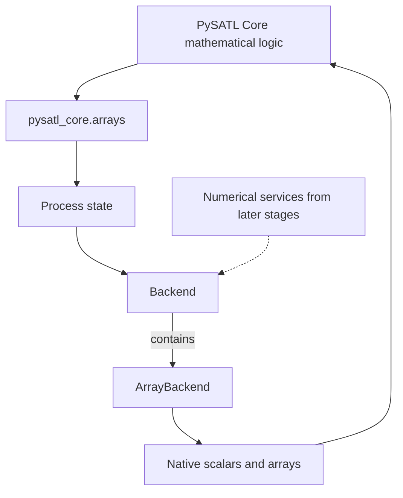

## Architecture

### Root composition

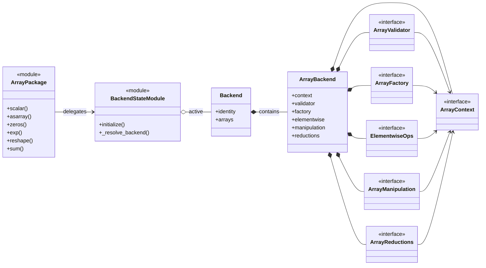

- `ArrayPackage` contains the functions called by formulas and characteristic conversions.
- `BackendStateModule` stores the active process backend and resolves the default backend on the first call.
- `Backend` connects the implementation identity with the array operation facade; the device and default data type are stored only in `ArrayContext`.
- `ArrayBackend` provides a consistent component set to package functions.
- `ArrayContext` stores the device, default data type, and supported capabilities.
- `ArrayValidator` inspects concrete values and validates them against the supplied contract.
- The validator is called when processing public input; internal operation implementations share one `ArrayContext`.

All components are selected when the backend is created. A package function retrieves the assembled implementation through `_resolve_backend`; no backend-name lookup occurs for every operation.

`create_backend` is an internal assembly function, not a separate interface. It creates `ArrayContext`, `ArrayValidator`, and the operation implementations, assembles `ArrayBackend`, and returns a ready `Backend`. `ArrayFactory` has a different responsibility: it creates scalars and arrays during computations.

### Package API

| Module | Functions | Internal implementation |
|---|---|---|
| `arrays.creation` | `scalar`, `asarray`, `zeros`, `empty`, `linspace`, `arange` | `ArrayFactory` |
| `arrays.elementwise` | `add`, `multiply`, `exp`, `log`, `where`, comparisons | `ElementwiseOps` |
| `arrays.manipulation` | `reshape`, `stack`, `getitem`, `setitem`, `unique` | `ArrayManipulation` |
| `arrays.reductions` | `sum`, `min`, `max`, `all`, `cumsum` | `ArrayReductions` |
| `arrays.__init__` | Re-exports functions for calls such as `arrays.exp(...)` | Corresponding internal component |

Package functions contain no mathematical logic. They retrieve the active backend through `_resolve_backend` and delegate the call to the appropriate `ArrayBackend` component.

### Data model

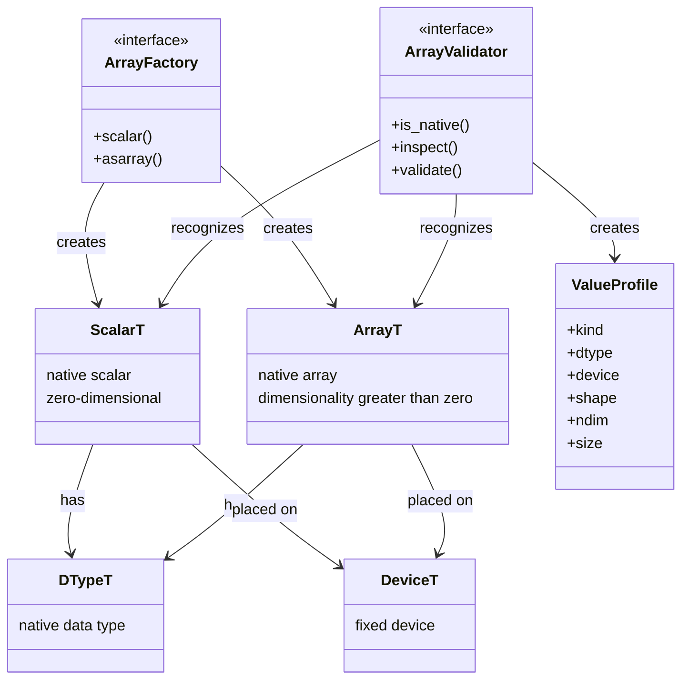

- `ArrayT` is the native array of the selected implementation.
- `ScalarT` is the native scalar value of the selected implementation.
- `DTypeT` and `DeviceT` remain native to the backend.
- `ValueProfile` stores value kind, data type, device, and shape.
- `ArrayValidator` validates backend ownership and builds `ValueProfile`.
- `ArrayFactory` creates scalars and arrays using the shared context.

### Context, validation, and factory

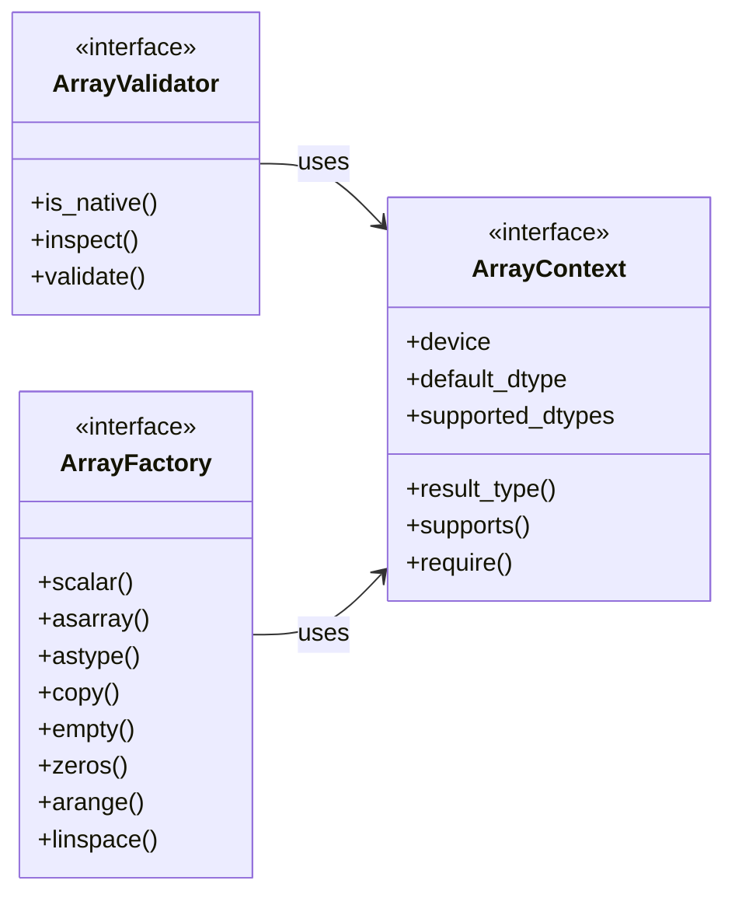

<details>
<summary>Full ArrayContext, ArrayValidator, and ArrayFactory API</summary>

- `ArrayContext`: `device`, `default_dtype`, `supported_dtypes`, `result_type`, `supports`, `require`.
- `ArrayValidator`: `is_native`, `inspect`, `validate`.
- `ArrayFactory`: `scalar`, `asarray`, `astype`, `copy`, `empty`, `zeros`, `empty_like`, `zeros_like`, `full_like`, `arange`, `linspace`, `pi`, `nan`, `inf`.

</details>

- `ArrayContext` owns static configuration, type promotion, and operation support.
- `ArrayValidator` builds `ValueProfile` and validates a value against the supplied contract.
- `ArrayFactory` creates and converts values on the `ArrayContext` device.
- `result_type` applies the selected implementation's promotion rules.

### Element-wise operations

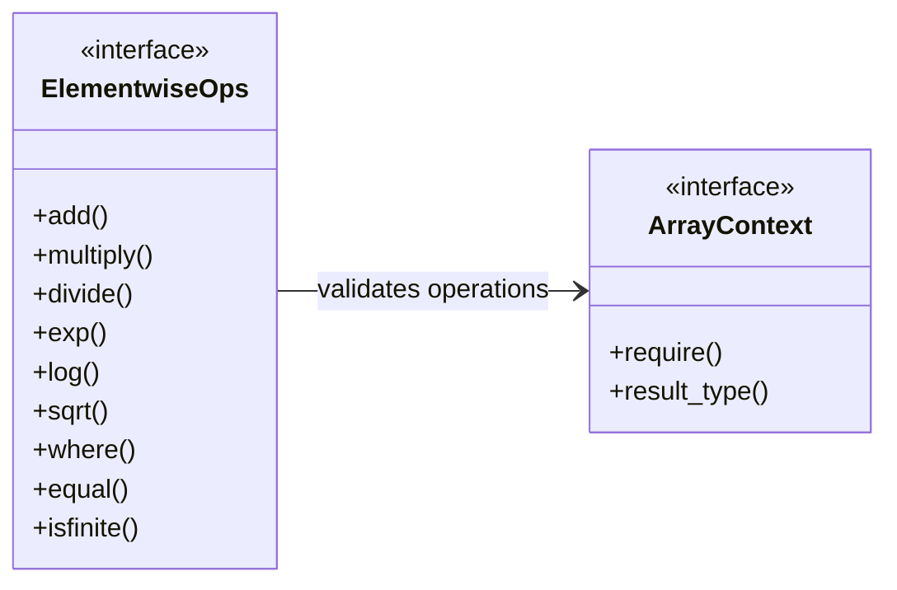

<details>
<summary>Full ElementwiseOps API</summary>

- Arithmetic: `add`, `subtract`, `multiply`, `divide`, `floor_divide`, `remainder`, `power`, `negative`, `minimum`, `maximum`, `where`.
- Functions: `exp`, `log`, `log1p`, `sqrt`, `abs`, `sinc`, `floor`, `round`, `clip`, `nextafter`.
- Comparisons and logic: `equal`, `not_equal`, `less`, `less_equal`, `greater`, `greater_equal`, `logical_and`, `logical_or`, `logical_not`.
- Value checks: `isfinite`, `isnan`, `isinf`, `isclose`, `nan_to_num`.
- Complex values: `real`, `imag`.

</details>

`ElementwiseOps` combines operations with the same element-wise semantics: arithmetic, functions, comparisons, masks, and complex-value operations.

### Shape, indexing, and reductions

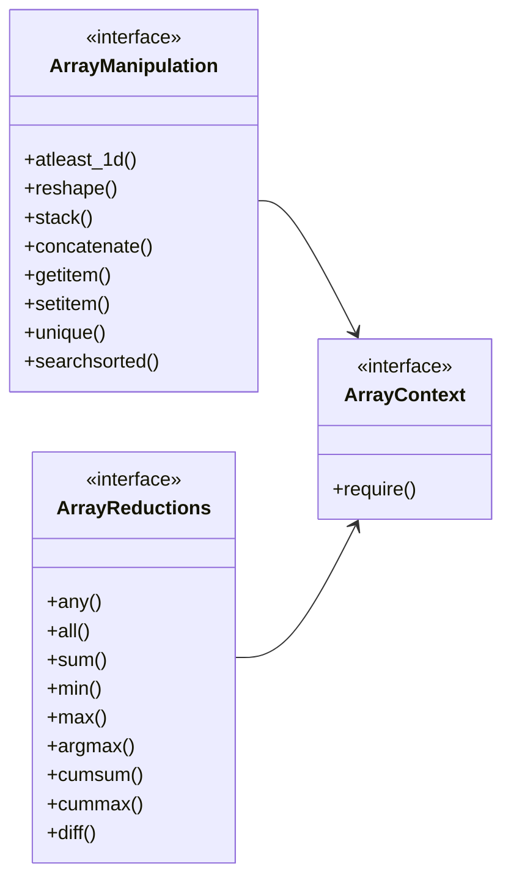

<details>
<summary>Full ArrayManipulation and ArrayReductions API</summary>

- `ArrayManipulation`: `atleast_1d`, `reshape`, `flatten`, `expand_dims`, `stack`, `concatenate`, `getitem`, `setitem`, `take`, `nonzero`, `unique`, `scatter_add`, `argsort`, `searchsorted`.
- `ArrayReductions`: `any`, `all`, `sum`, `min`, `max`, `argmax`, `cumsum`, `cummax`, `diff`.

</details>

- `ArrayManipulation` changes shape and performs indexing, sorting, and functional updates.
- `ArrayReductions` reduces values and builds cumulative results.
- `setitem` returns the updated array; callers do not assume that the original object was mutated.

### Call from a formula

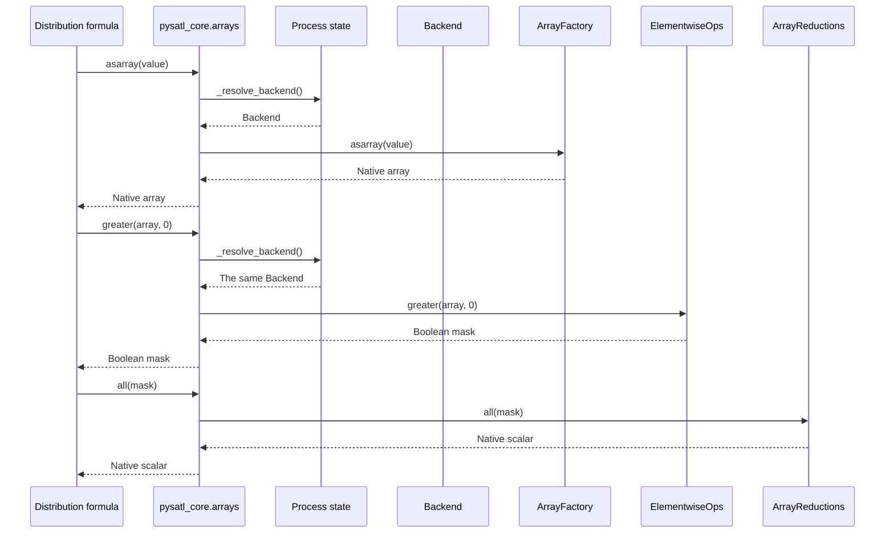

A formula sees only package functions. `_resolve_backend` performs a fast read of the backend already fixed for the process, and the function delegates the call to the corresponding internal component.

## Interaction sequences

### Backend initialization

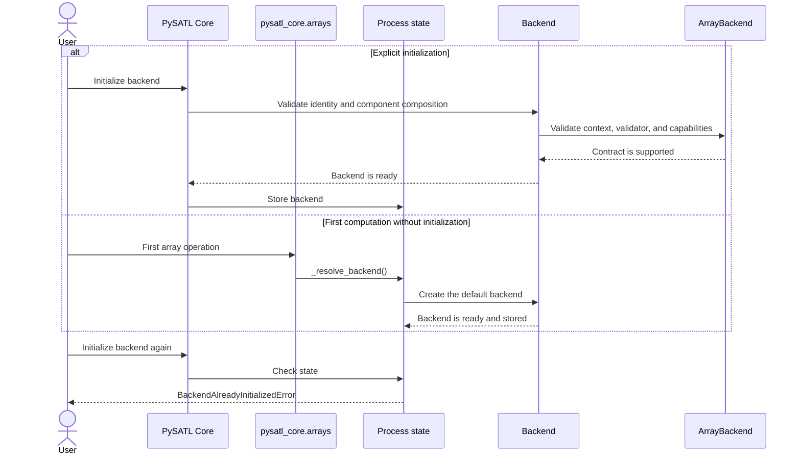

The state module stores only a successfully validated object. A validation error leaves the process without an active backend, while reinitialization after success does not change the state.

### Characteristic evaluation

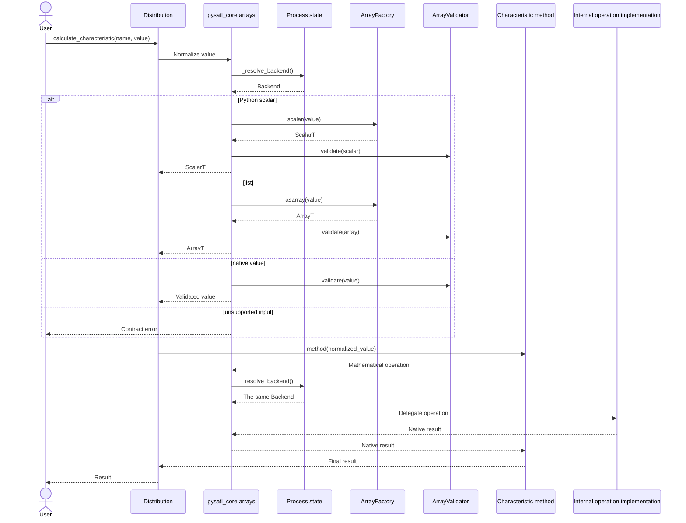

The public boundary normalizes the input through package functions. The computation method also calls `pysatl_core.arrays`; a `Backend` reference is not passed through its signature.

### Operation validation

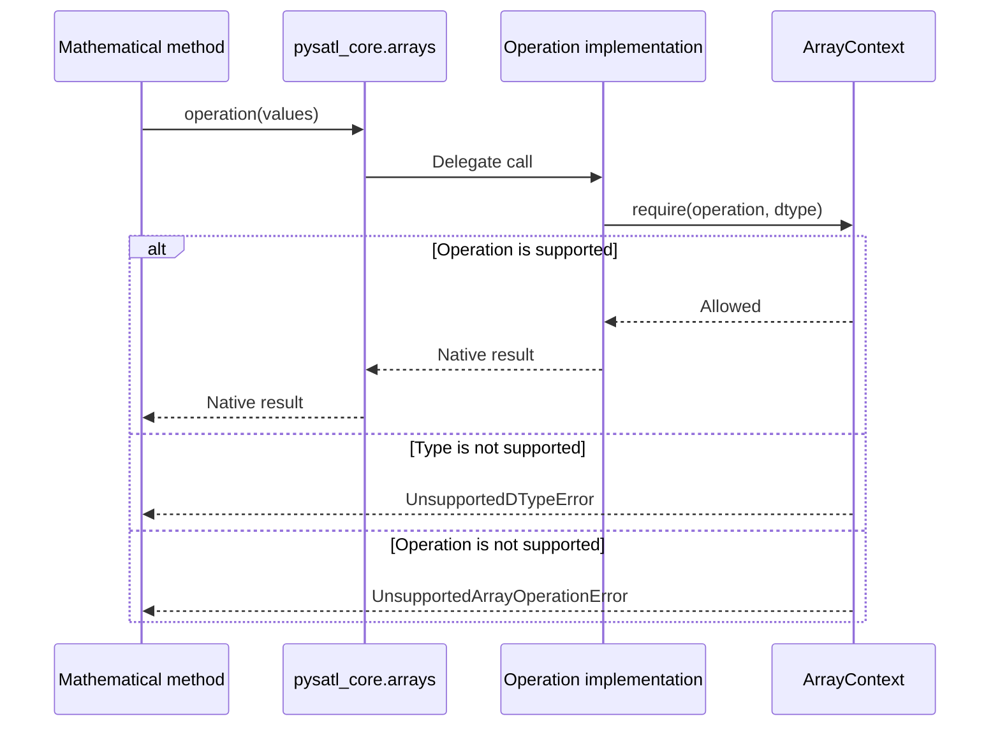

`ArrayContext` validates operation capability. An unsupported combination does not activate another backend or transfer data to another device.

## Data rules

### Public input and result

| Input | Normalization | Element-wise characteristic result |
|---|---|---|
| Python scalar | `scalar` | Native scalar |
| `list` | `asarray` | Native array |
| Native scalar | Validation | Native scalar |
| Native array | Validation | Native array with the agreed shape |
| `tuple` | Rejected | Input contract error |
| Foreign array | Rejected | Backend ownership error |
| Different device | Rejected | Device error |

### Value validation

`ArrayValidator` provides three operations:

- `is_native` determines whether a value belongs to the active backend;
- `inspect` builds `ValueProfile` without checking a method contract;
- `validate` checks a value against the supplied contract and returns its profile.

`ValueProfile` contains value kind, `dtype`, device, shape, dimensionality, and element count. The caller supplies the `ValueContract`.

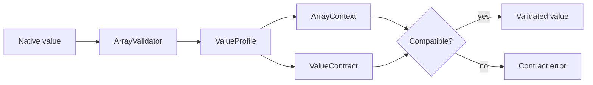

| Check | Error |
|---|---|
| Value belongs to another backend | `ForeignArrayError` |
| Device differs from the active device | `DeviceMismatchError` |
| `dtype` is unsupported | `UnsupportedDTypeError` |
| Shape or dimensionality violates the contract | `ArrayShapeError` |

### Data types

1. An explicitly requested type takes precedence when supported.
2. A value created relative to an existing array or scalar inherits its type.
3. Multiple operands use the backend's native type-promotion rules.
4. Python `bool` creates a Boolean value, Python `int` an integer value, Python `float` a `float64` value, and Python `complex` a complex type based on `float64`.
5. A factory without an input value or explicit type uses `float64`.

### Device

All new and temporary values are created on the active backend device. Operations reject values from another device. The shared interface never transfers data between devices implicitly.

## Integration with the existing PySATL Core

The new layer does not change characteristic selection.

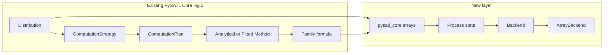

Changes to existing components:

| Component | Integration |
|---|---|
| `Distribution.calculate_characteristic` | Normalizes and validates public input through `pysatl_core.arrays` |
| `ArrayValidator` | Builds `ValueProfile` and validates a value against the supplied contract |
| Public `query_method` | Returns a callable wrapper that applies the input contract |
| Internal method resolution | Returns the raw function without repeating public normalization at every step |
| `ComputationStrategy` | Continues to choose the path and algorithm; the backend does not make those decisions |
| `ComputationPlan` | Stores requirements and the identity of the backend for which the path was built |
| `AnalyticalComputation` | Calls `pysatl_core.arrays` package functions |
| `FittedComputationMethod` | Stores a prepared algorithm bound to the same backend and device |
| Built-in families | Replace direct numerical-library calls with `arrays.*` functions |
| `Support.contains` | Builds a native Boolean scalar or mask through `arrays.*` functions |
| `types.py` | Stops defining public arrays exclusively through NumPy types |
| Characteristic conversions | Use package functions for shape, indexing, and reductions |

The characteristic graph remains unchanged. `ComputationStrategy` still selects an analytical loop or a conversion sequence. `Backend` is responsible only for executing the operations selected by the method.

### Graph plan execution

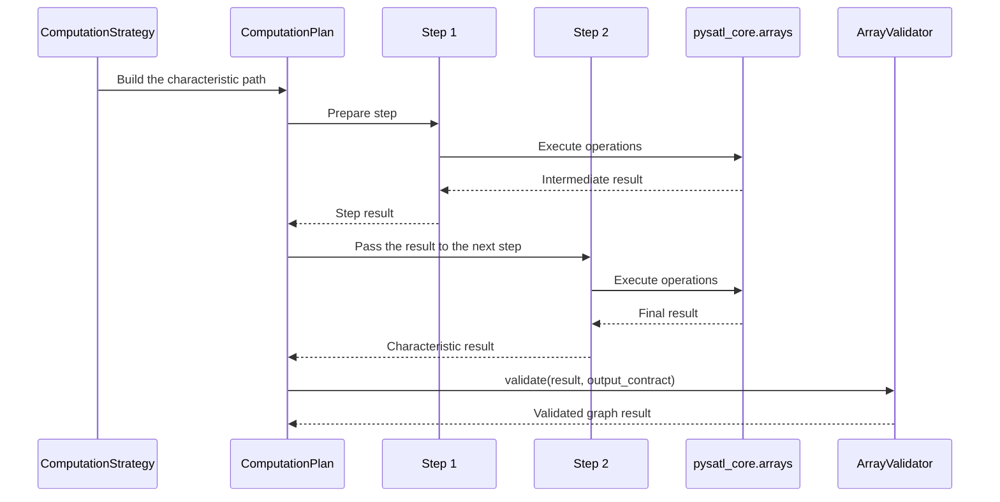

If the final graph result violates its output contract, `ComputationPlan` stops execution with `UnexpectedResultError`.

The mathematical path and algorithm parameters remain unchanged. Only data creation and operation execution change.

## Characteristic graph and backend requirements

The graph remains a graph of distribution characteristics. Its nodes are PDF, CDF, PPF, PMF, and other characteristics; its edges are methods for obtaining a target characteristic from source characteristics. The graph is not duplicated for each backend.

The new architecture adds a requirement declaration to every computation method. The strategy uses it as a filter before path search.

### Requirement ownership

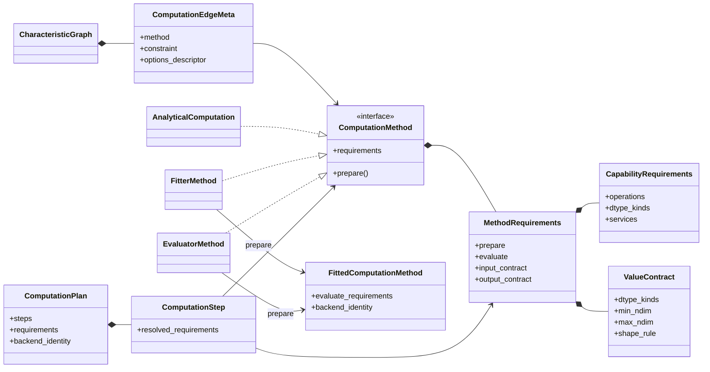

- `AnalyticalComputation`, `FitterMethod`, and `EvaluatorMethod` declare requirements next to their implementation.
- `FittedComputationMethod` receives evaluation requirements and is bound to the backend on which it was prepared.
- `ComputationEdgeMeta` does not duplicate requirements because the edge already references the method.
- `ComputationStep` stores the selected method requirements after options are resolved.
- `ComputationPlan` merges step requirements and records the active backend identity.
- `GraphPrimitiveConstraint` continues to validate distribution properties and contains no backend restrictions.
- `CapabilityRequirements` describes the operations, dtype categories, and numerical services required by the method. `ArrayContext` checks these requirements during route construction.
- `ValueContract` defines allowed dtype categories, dimensionality, and shape rules. The strategy matches adjacent step contracts, while `ArrayValidator` validates the final graph result.

Before execution, the plan compares the recorded identity with the active backend from the state module. A mismatch raises a compatibility error; the plan never switches the backend itself.

### Method requirement structure

| Part | Contents |
|---|---|
| Preparation | Operations required to build grids, tables, and the prepared method |
| Evaluation | Operations called by the prepared method when processing an input |
| Input contract | A `ValueContract` with allowed dtype categories, dimensionality, and input shape |
| Output contract | A `ValueContract` with the expected dtype, dimensionality, and result-shape relation to the input |
| Capabilities | `CapabilityRequirements` with operations, dtype categories, and additional numerical services |

Separating preparation and evaluation matters for `FitterMethod`: preparation may build a table, while the prepared method may only search and select values.

### Route construction

```mermaid
sequenceDiagram
    participant S as ComputationStrategy
    participant G as RegistryView
    participant E as ComputationEdgeMeta
    participant M as ComputationMethod
    participant State as Process state
    participant C as ArrayContext
    participant P as ComputationPlan

    S->>State: _resolve_backend()
    State-->>S: ArrayContext of the active backend
    S->>G: Get edges for the distribution
    G-->>S: Candidates after GraphPrimitiveConstraint

    loop Each edge
        S->>E: Get method
        E-->>S: ComputationMethod
        S->>M: Get requirements
        M-->>S: MethodRequirements
        S->>C: supports(requirements.prepare, requirements.evaluate)

        alt Capability requirements are supported
            C-->>S: Edge is available
        else Capabilities are insufficient
            C-->>S: Incompatibility reason
            S->>S: Exclude edge
        end
    end

    S->>G: Find a path through available edges
    G-->>S: Compatible path
    S->>P: Create steps and merge requirements
```

Backend capabilities act as a filter. `ComputationStrategy` remains responsible for selecting the mathematical path.

### Path selection rules

```mermaid
flowchart TD
    All[All graph edges] --> Domain[Filter by distribution properties]
    Domain --> Capabilities[Filter by method requirements]
    Capabilities --> Available{Any paths left?}
    Available -->|no| Error[No compatible computation path]
    Available -->|yes| Explicit{Was the method selected explicitly?}
    Explicit -->|yes| Requested[Validate the requested variant]
    Explicit -->|no| ExistingRules[Apply current priorities and labels]
    Requested --> Plan[ComputationPlan]
    ExistingRules --> Plan
```

If the user explicitly selected an incompatible method, the strategy returns an error and does not replace it with another variant. During automatic selection, incompatible edges are removed before current priorities are applied.

### Validation stages

| Stage | What can be validated |
|---|---|
| Path construction | Operation availability, `dtype` families, complex values, and general device restrictions |
| Step preparation | Method parameters, the exact working type, and preparation-algorithm requirements |
| Execution | `ArrayValidator` checks the final graph result: shape, device, `NaN`, infinities, and the output contract |

The plan requirements are the union of its step requirements. Operations are merged, while adjacent step input and output restrictions must be compatible.

Parameters such as tolerance or iteration count should not change the operation set. If a parameter selects a different algorithm, that algorithm should be registered as a separate method variant with its own requirements.

If no compatible path exists, the error must list rejected methods and missing operations, types, or services. A recording test backend validates the declaration: operations actually called by a method must be included in its declared requirements.

## Current stage scope

This stage includes:

- the `Backend` lifecycle;
- `pysatl_core.arrays` package functions and delegation;
- the composed `ArrayBackend` interface;
- `ArrayValidator`, `ValueProfile`, and value-contract validation;
- scalar, array, data type, and device rules;
- public input normalization;
- contract errors and tests;
- migration of one analytical characteristic to validate the boundaries.

This stage excludes:

- integration and root finding;
- interpolation;
- special functions outside the required array interface;
- random number generators;
- parameter optimization;
- adapters for external CPU libraries.

These areas will be attached to the root backend as separate services. They must not extend `ArrayBackend` with operations unrelated to arrays.

## Implementation order

```mermaid
flowchart LR
    Interfaces[Internal interfaces] --> State[Process state]
    State --> Reference[First implementation]
    Reference --> PackageAPI[pysatl_core.arrays package]
    PackageAPI --> ContractTests[Contract tests]
    ContractTests --> Normalize[Input normalization]
    Normalize --> Vertical[One analytical characteristic]
    Vertical --> Compare[Comparison with current behavior]
    Compare --> Decision{Is the contract validated?}
    Decision -->|no| Refine[Refine interfaces]
    Refine --> ContractTests
    Decision -->|yes| Migration[Migrate the remaining formulas]
```

First, implement the interfaces, process state, and contract tests. Then migrate one complete path, including temporary arrays and graph output-contract validation. Bulk replacement of current-library calls starts only after the boundaries are validated on this vertical scenario.
