# Архитектура бекенда и операций над массивами в PySATL Core

Документ объединяет основные результаты исследования текущего кода PySATL Core и проект выбранной архитектуры. Здесь сохранены только факты, влияющие на архитектурное решение.

Исследование выполнено по коммиту [`37f7679`](https://github.com/PySATL/pysatl-core/tree/37f767964350569b354df4efcb552d0b2d9a3fb6).

## Терминология

- **Бекенд** — корневой объект выбранной вычислительной реализации.
- **Бекенд массивов** — набор интерфейсов для создания, проверки и обработки скаляров и массивов.
- **Валидатор массивов** — компонент, который анализирует нативные значения и проверяет их по контракту метода.
- **Пакет массивов** — набор функций `pysatl_core.arrays`, используемый формулами и переходами характеристик.
- **Нативное значение** — скаляр или массив в представлении активного бекенда без общей объектной обёртки.
- **Нормализация** — однократное преобразование публичного входа в нативное значение.
- **Тип данных** — нативное обозначение `dtype`, которым управляет бекенд.
- **Устройство** — место выполнения и хранения данных, зафиксированное для процесса.
- **Возможность** — поддерживаемая комбинация операции, типа данных и устройства.
- **Стандартный бекенд** — реализация, создаваемая при первом вычислении без явной инициализации.
- **Контрактный тест** — один и тот же тест поведения, запускаемый для каждой реализации интерфейса.

## Краткие результаты исследования

Текущий код использует NumPy и SciPy одновременно как представление данных, набор математических операций и реализацию отдельных алгоритмов. Прямые импорты этих библиотек встречаются в 33 из 78 Python-файлов пакета.


### Текущий публичный вызов

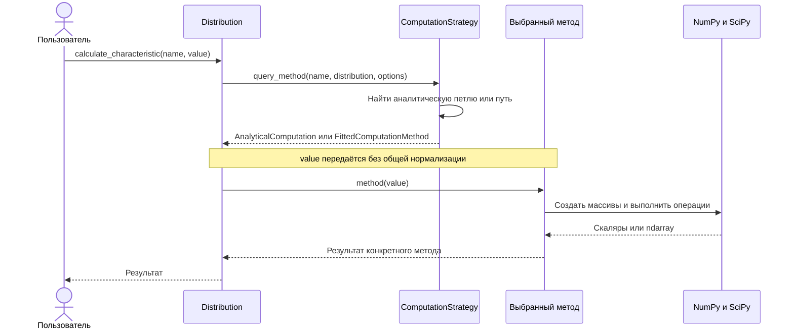

`Distribution` выбирает метод через стратегию и сразу передаёт ему пользовательское значение. Тип входа и форма результата зависят от выбранного метода.

### Текущий графовый путь

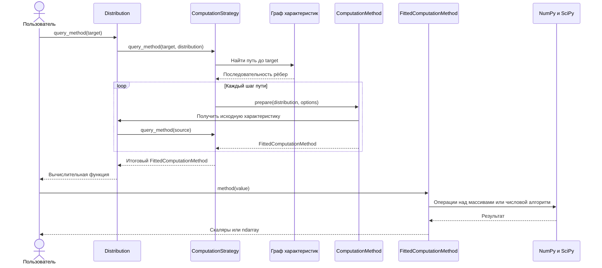

Публичный `query_method` возвращает вычислительную функцию напрямую. Внутренние шаги получают другие характеристики через тот же публичный путь, а операции выполняют конкретные библиотеки.

### Библиотечные зависимости

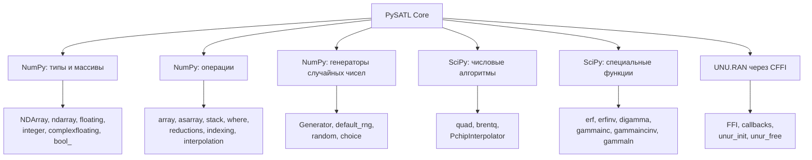

NumPy одновременно задаёт типы, хранит данные и выполняет большую часть операций. SciPy предоставляет алгоритмы и специальные функции. UNU.RAN использует отдельную CFFI-границу и CPU-скаляры.

| Библиотека | Используемые сущности | Где применяются |
|---|---|---|
| NumPy: типы и управление вычислением | `NDArray`, `ndarray`, `floating`, `integer`, `complexfloating`, `bool_`, `float64`, `intp`, `inf`, `nan`, `pi`, `errstate` | Публичные псевдонимы, типизация, константы и обработка числовых предупреждений |
| NumPy: создание и форма | `array`, `asarray`, `atleast_1d`, `empty`, `zeros`, `full_like`, `arange`, `linspace`, `fromiter`, `stack`, `concatenate` | Формулы, переходы характеристик, сетки, таблицы и выборки |
| NumPy: математика | `exp`, `log`, `log1p`, `sqrt`, `power`, `sinc`, `clip`, `where`, `minimum`, `maximum` | Аналитические формулы и преобразования распределений |
| NumPy: редукции и индексы | `sum`, `min`, `max`, `argmax`, `cumsum`, `diff`, `argsort`, `searchsorted`, `nonzero`, `unique`, `add.at`, `maximum.accumulate` | Дискретные таблицы, маски, сортировка и накопление вероятностей |
| NumPy: проверки | `isfinite`, `isnan`, `isinf`, `isclose`, `nan_to_num` | Проверка параметров, границ и результатов приближения |
| NumPy: случайность | `Generator`, `default_rng`, `random`, `choice` | Инверсная выборка, смеси и URNG для UNU.RAN |
| SciPy: алгоритмы | `quad`, `brentq`, `PchipInterpolator` | Интегрирование, обращение характеристик и монотонная интерполяция |
| SciPy: специальные функции | `erf`, `erfinv`, `digamma`, `gammainc`, `gammaincinv`, `gammaln` | Семейства Normal и Gamma |
| CFFI и UNU.RAN | `FFI`, `ffi.callback`, `unur_init`, `unur_free`, `unur_distr_*` | `DefaultUnuranSampler`, `UnuranSamplerInitializer`, `UnuranCallback`, `DGTSetup` |

Классы приближений также зависят от конкретных библиотечных реализаций: `CDFMonotoneSplineApproximation` и `PPFMonotoneSplineApproximation` используют `PchipInterpolator`, а `PDFLinearInterpolationApproximation` — `numpy.interp`.

### Текущие типы данных

Публичные псевдонимы в `types.py` напрямую выражены через NumPy:

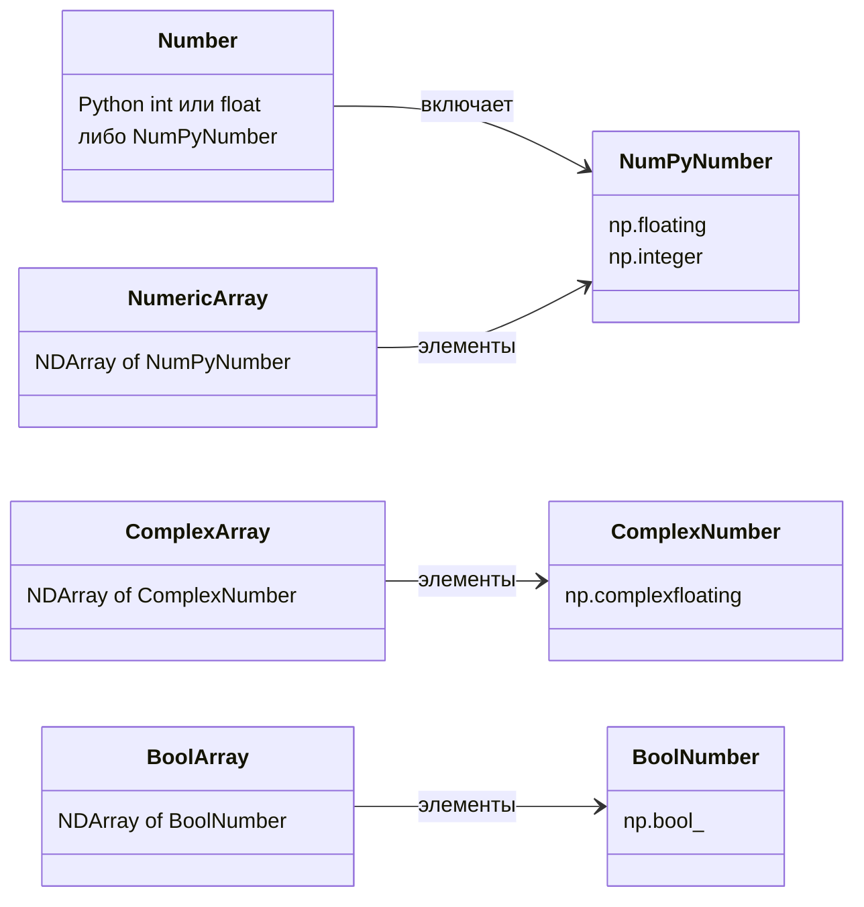

| Тип | Текущее определение | Использование |
|---|---|---|
| `Number` | Python `int`, `float` или `NumPyNumber` | Параметры и скалярные границы |
| `NumPyNumber` | `np.floating` или `np.integer` | Элемент вещественного числового массива |
| `NumericArray` | `NDArray[NumPyNumber]` | PDF, CDF, PPF, PMF, сетки и выборки |
| `ComplexArray` | `NDArray[np.complexfloating]` | Характеристические функции |
| `BoolArray` | `NDArray[np.bool_]` | Области определения, проверки и маски |
| Индексные массивы | Обычно `np.intp` | Сортировка, поиск и выбор элементов |

Большинство вычислительных путей явно приводит вещественные данные к `float64`, комплексные результаты — к `complex128`. Маски используют `bool`, индексы — `intp`. В коде также встречаются Python-скаляры, NumPy-скаляры и нульмерные массивы; они не сведены к одному публичному контракту.

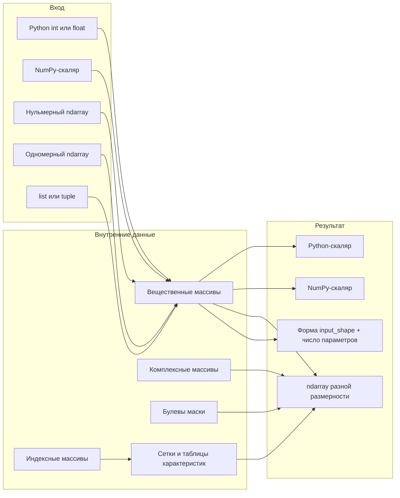

Форму результата определяет конкретный путь. Аналитическая формула может вернуть скаляр, а графовый переход — массив формы `(1,)`. Градиенты добавляют ось параметров, булевы проверки возвращают маски, а выборки обычно имеют форму `(n,)`.

Ключевые точки текущей реализации:

| Область | Текущий код | Значение для архитектуры |
|---|---|---|
| Публичное вычисление | [`distribution.py`](https://github.com/PySATL/pysatl-core/blob/37f767964350569b354df4efcb552d0b2d9a3fb6/src/pysatl_core/distributions/distribution.py#L352-L389) | Здесь должна начинаться нормализация входа |
| Выбор метода | [`strategies.py`](https://github.com/PySATL/pysatl-core/blob/37f767964350569b354df4efcb552d0b2d9a3fb6/src/pysatl_core/distributions/strategies.py#L656-L794) | Публичный метод должен возвращать контрактную обёртку |
| Публичные типы | [`types.py`](https://github.com/PySATL/pysatl-core/blob/37f767964350569b354df4efcb552d0b2d9a3fb6/src/pysatl_core/types.py) | NumPy-зависимые типы нужно отделить от публичного контракта |
| Области определения | [`support.py`](https://github.com/PySATL/pysatl-core/blob/37f767964350569b354df4efcb552d0b2d9a3fb6/src/pysatl_core/distributions/support.py) | Булевы скаляры и маски должны стать нативными |
| Переходы характеристик | [`computations`](https://github.com/PySATL/pysatl-core/tree/37f767964350569b354df4efcb552d0b2d9a3fb6/src/pysatl_core/distributions/computations) | Нужны операции над временными массивами и отдельные числовые сервисы |
| Формулы семейств | [`families/builtins`](https://github.com/PySATL/pysatl-core/tree/37f767964350569b354df4efcb552d0b2d9a3fb6/src/pysatl_core/families/builtins) | Поэлементная математика должна использовать бекенд массивов |

Исследование показывает, что замены отдельных `np.*` недостаточно. Общий контракт должен охватывать публичный вход, временные значения, математические операции и результат.

## Рассмотренные варианты

| Вариант | Плюсы | Минусы |
|---|---|---|
| Оставить прямые вызовы числовой библиотеки | Нет архитектурной миграции | Нельзя подключить другую реализацию без изменения доменного кода |
| Использовать только глобальные функции без внутренних интерфейсов | Небольшие изменения формул | Нет явного контракта реализации и отдельных контрактных тестов |
| Ввести универсальный класс массива PySATL | Единый публичный тип | Придётся повторять протокол нативных массивов и скрывать их возможности |
| Реализовать все формулы отдельно для каждого бекенда | Полный контроль реализации | Дублирование математической логики и расхождение алгоритмов |
| Пакетные функции поверх `Backend` и составного `ArrayBackend` | Простой API формул и явный внутренний контракт | Требуется поэтапно перенести полный вычислительный путь |

Выбран последний вариант по следующим причинам:

1. Математическая логика остаётся общей и не дублируется для каждого бекенда.
2. Скаляры и массивы сохраняют нативное представление без универсальной обёртки PySATL.
3. `ArrayContext` хранит единые для процесса устройство и тип данных по умолчанию.
4. Формулы используют единый пакет `pysatl_core.arrays`, а внутренние интерфейсы разделяют создание данных, математику, индексирование и редукции.
5. Поддержка операции и `dtype` проверяется явно, без скрытого перехода к другой реализации.
6. Архитектуру можно внедрять поэтапно, сохраняя текущий граф характеристик и сравнивая результаты после каждого шага.
7. Интегрирование, интерполяция и другие числовые алгоритмы подключаются к корневому бекенду отдельными сервисами и не раздувают интерфейс массивов.

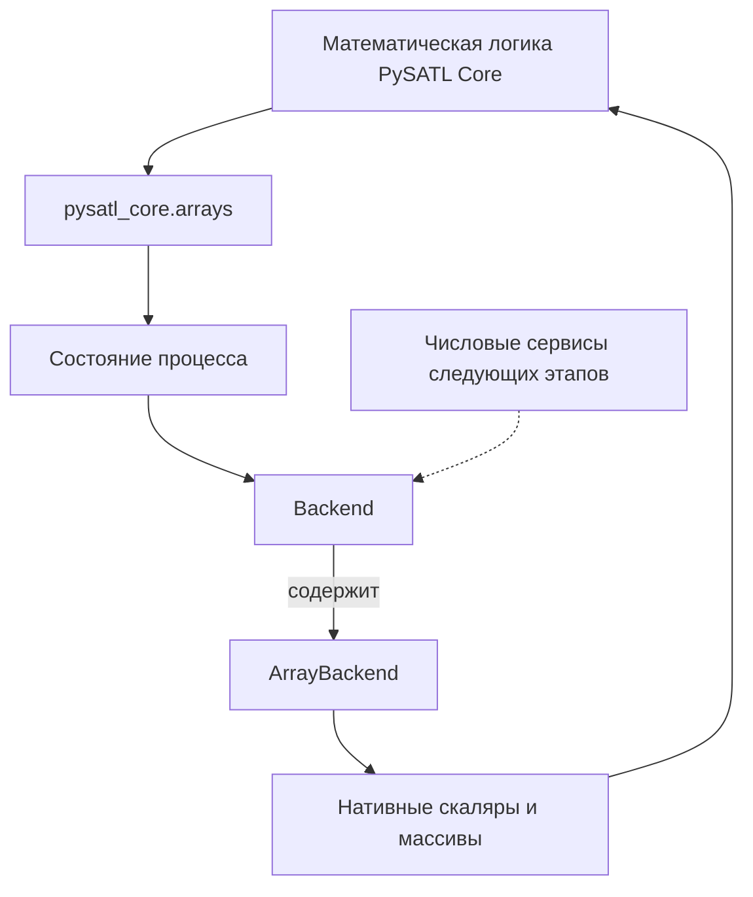

## Общая архитектура

### Корневая композиция

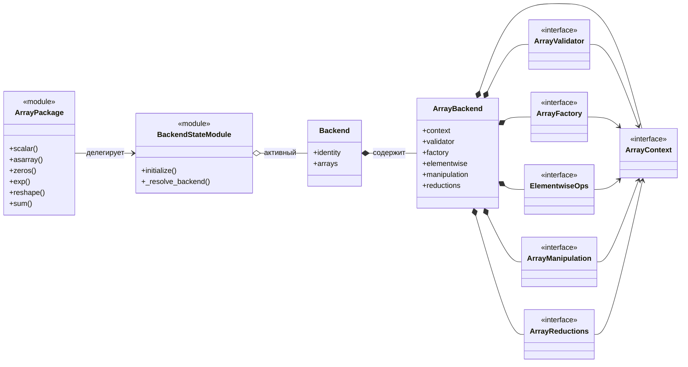

- `ArrayPackage` — функции, которые вызывают формулы и переходы характеристик.
- `BackendStateModule` хранит активный бекенд процесса и разрешает стандартный при первом вызове.
- `Backend` связывает идентичность реализации и фасад операций над массивами; устройство и тип по умолчанию хранятся только в `ArrayContext`.
- `ArrayBackend` предоставляет пакетным функциям согласованный набор компонентов.
- `ArrayContext` хранит устройство, тип по умолчанию и поддерживаемые возможности.
- `ArrayValidator` анализирует конкретные значения и проверяет их по переданному контракту.
- Валидатор вызывается при обработке публичного входа; внутренние реализации операций используют общий `ArrayContext`.

Все компоненты выбираются при создании бекенда. Пакетная функция получает уже собранную реализацию через `_resolve_backend`; поиск по имени бекенда на каждой операции не выполняется.

`create_backend` — внутренняя функция сборки, а не отдельный интерфейс. Она создаёт `ArrayContext`, `ArrayValidator` и реализации операций, собирает `ArrayBackend` и возвращает готовый `Backend`. `ArrayFactory` имеет другую задачу: она создаёт скаляры и массивы уже во время вычислений.

### Пакетный API

| Модуль | Функции | Внутренняя реализация |
|---|---|---|
| `arrays.creation` | `scalar`, `asarray`, `zeros`, `empty`, `linspace`, `arange` | `ArrayFactory` |
| `arrays.elementwise` | `add`, `multiply`, `exp`, `log`, `where`, сравнения | `ElementwiseOps` |
| `arrays.manipulation` | `reshape`, `stack`, `getitem`, `setitem`, `unique` | `ArrayManipulation` |
| `arrays.reductions` | `sum`, `min`, `max`, `all`, `cumsum` | `ArrayReductions` |
| `arrays.__init__` | Реэкспорт функций для вызовов вида `arrays.exp(...)` | Соответствующий внутренний компонент |

Пакетные функции не содержат математической логики. Они получают активный бекенд через `_resolve_backend` и передают вызов нужному компоненту `ArrayBackend`.

### Модель данных

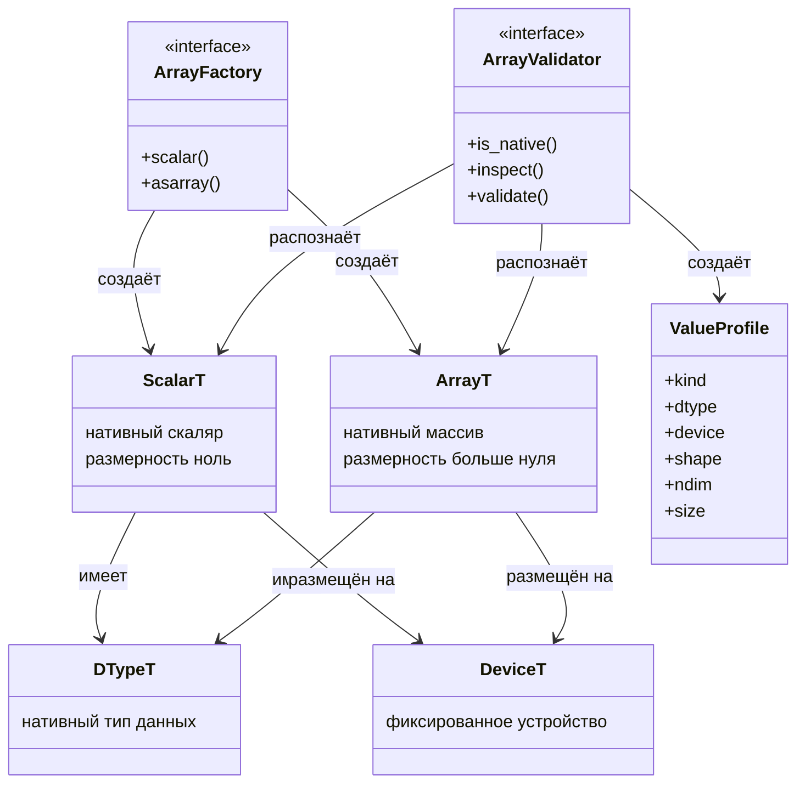

- `ArrayT` — нативный массив выбранной реализации.
- `ScalarT` — нативное скалярное значение выбранной реализации.
- `DTypeT` и `DeviceT` остаются нативными для бекенда.
- `ValueProfile` хранит вид значения, тип, устройство и форму.
- `ArrayValidator` проверяет принадлежность значения бекенду и строит `ValueProfile`.
- `ArrayFactory` создаёт скаляры и массивы с использованием общего контекста.

### Контекст, валидация и фабрика

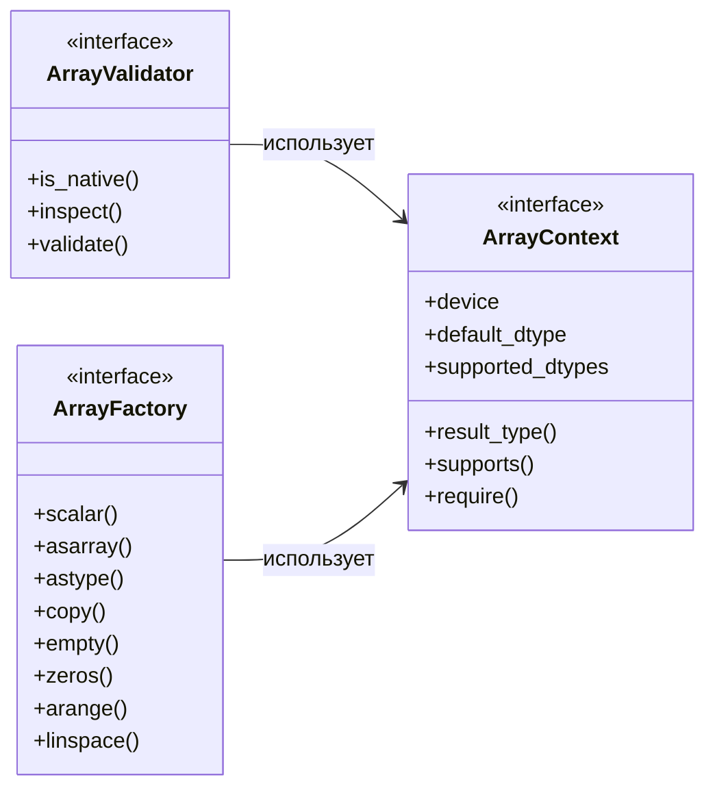

<details>
<summary>Полный состав ArrayContext, ArrayValidator и ArrayFactory</summary>

- `ArrayContext`: `device`, `default_dtype`, `supported_dtypes`, `result_type`, `supports`, `require`.
- `ArrayValidator`: `is_native`, `inspect`, `validate`.
- `ArrayFactory`: `scalar`, `asarray`, `astype`, `copy`, `empty`, `zeros`, `empty_like`, `zeros_like`, `full_like`, `arange`, `linspace`, `pi`, `nan`, `inf`.

</details>

- `ArrayContext` отвечает за статическую конфигурацию, продвижение типов и поддержку операций.
- `ArrayValidator` строит `ValueProfile` и проверяет значение по переданному контракту.
- `ArrayFactory` создаёт и преобразует значения на устройстве из `ArrayContext`.
- `result_type` применяет правила продвижения типов выбранной реализации.

### Поэлементные операции

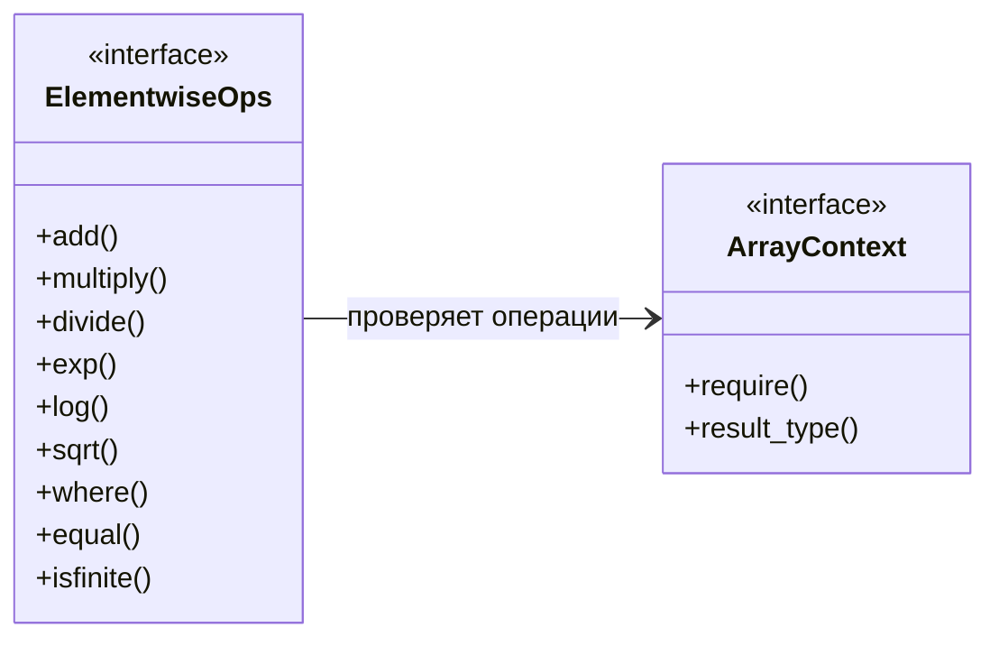

<details>
<summary>Полный состав ElementwiseOps</summary>

- Арифметика: `add`, `subtract`, `multiply`, `divide`, `floor_divide`, `remainder`, `power`, `negative`, `minimum`, `maximum`, `where`.
- Функции: `exp`, `log`, `log1p`, `sqrt`, `abs`, `sinc`, `floor`, `round`, `clip`, `nextafter`.
- Сравнения и логика: `equal`, `not_equal`, `less`, `less_equal`, `greater`, `greater_equal`, `logical_and`, `logical_or`, `logical_not`.
- Проверки значений: `isfinite`, `isnan`, `isinf`, `isclose`, `nan_to_num`.
- Комплексные значения: `real`, `imag`.

</details>

`ElementwiseOps` объединяет операции с одинаковой поэлементной семантикой: арифметику, функции, сравнения, маски и работу с комплексными значениями.

### Форма, индексирование и редукции

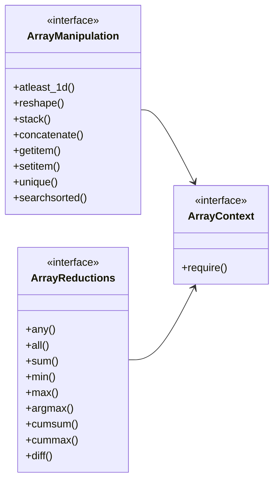

<details>
<summary>Полный состав ArrayManipulation и ArrayReductions</summary>

- `ArrayManipulation`: `atleast_1d`, `reshape`, `flatten`, `expand_dims`, `stack`, `concatenate`, `getitem`, `setitem`, `take`, `nonzero`, `unique`, `scatter_add`, `argsort`, `searchsorted`.
- `ArrayReductions`: `any`, `all`, `sum`, `min`, `max`, `argmax`, `cumsum`, `cummax`, `diff`.

</details>

- `ArrayManipulation` меняет форму, выполняет индексирование, сортировку и функциональные обновления.
- `ArrayReductions` сворачивает значения и строит накопительные результаты.
- `setitem` возвращает обновлённый массив; вызывающий код не рассчитывает на изменение исходного объекта.

### Вызов из формулы

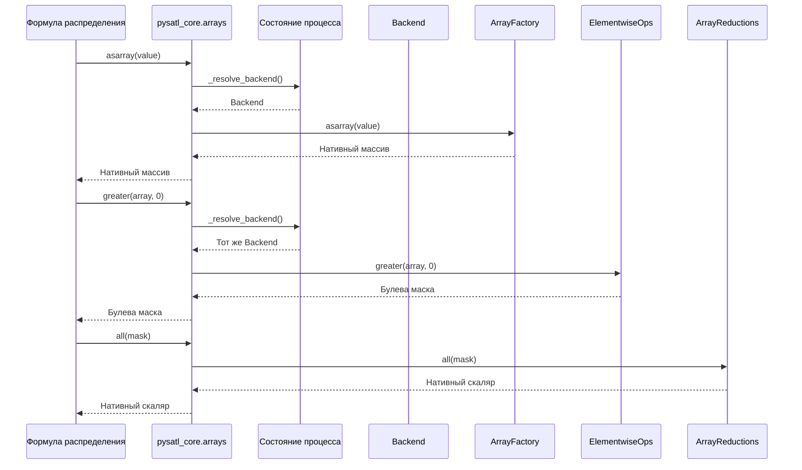

Формула видит только пакетные функции. `_resolve_backend` выполняет быстрое чтение уже зафиксированного бекенда, а функция делегирует вызов соответствующему внутреннему компоненту.

## Последовательности взаимодействия

### Инициализация бекенда

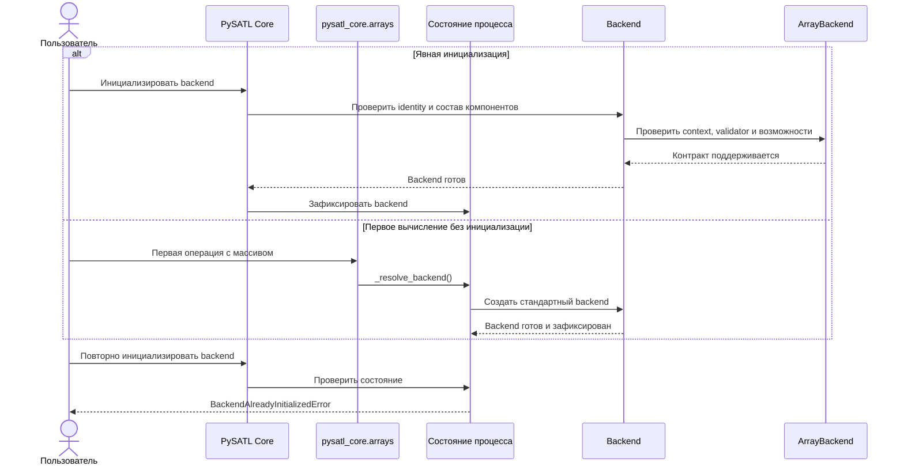

Модуль состояния фиксирует только успешно проверенный объект. Ошибка проверки оставляет процесс без активного бекенда, а повторная инициализация после успеха не меняет состояние.

### Вычисление характеристики

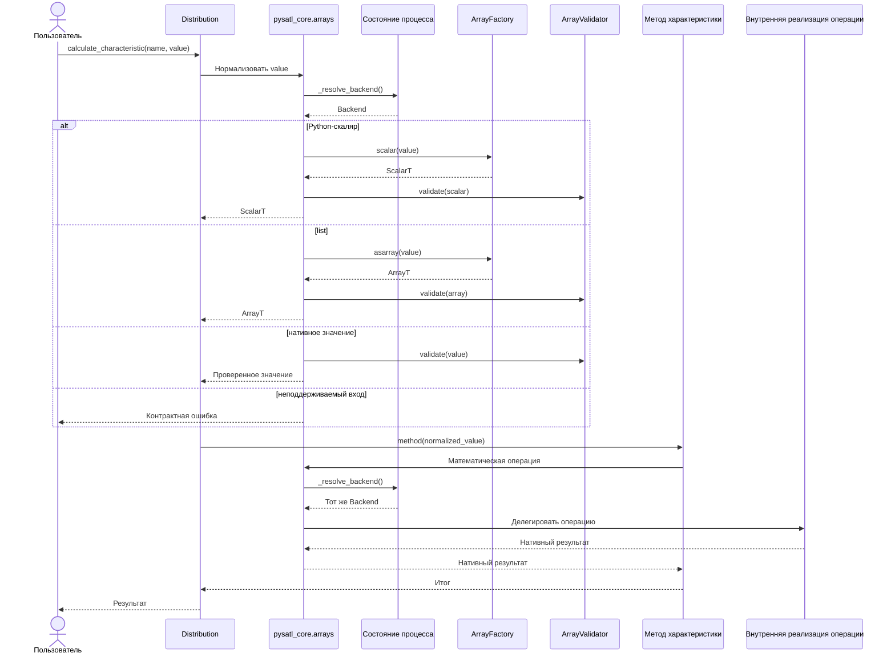

Публичная граница нормализует вход через пакетные функции. Вычислительный метод также вызывает пакет `pysatl_core.arrays`; ссылка на `Backend` через его сигнатуру не передаётся.

### Проверка операции

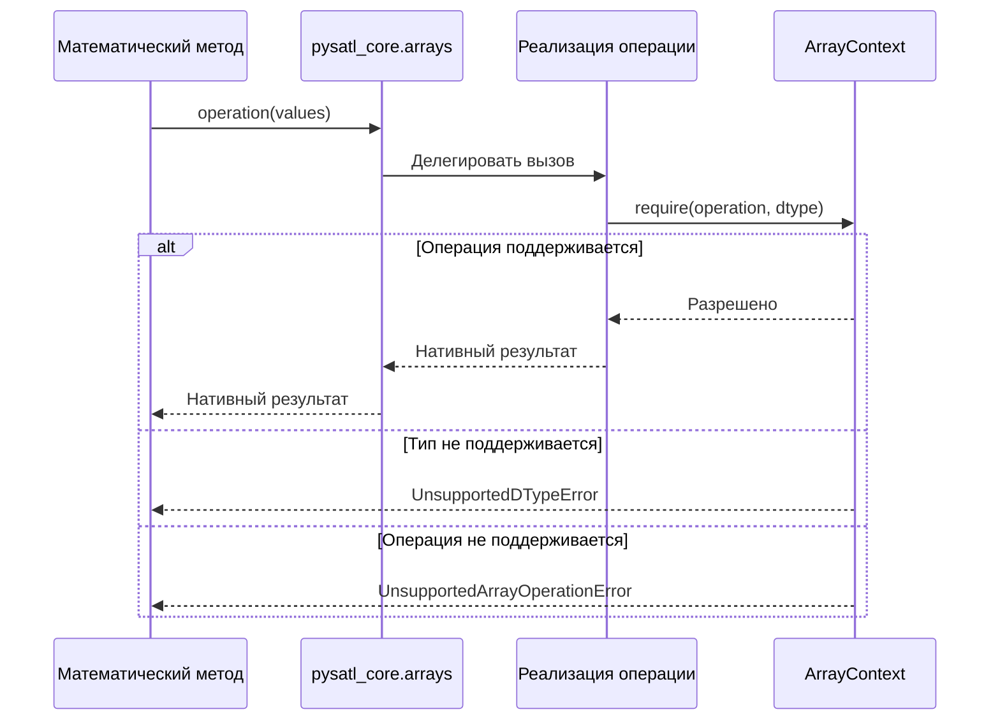

`ArrayContext` проверяет возможность операции. Неподдерживаемая комбинация не запускает другой бекенд и не переносит данные на другое устройство.

## Правила данных

### Публичный вход и результат

| Вход | Нормализация | Результат поэлементной характеристики |
|---|---|---|
| Python-скаляр | `scalar` | Нативный скаляр |
| `list` | `asarray` | Нативный массив |
| Нативный скаляр | Проверка | Нативный скаляр |
| Нативный массив | Проверка | Нативный массив согласованной формы |
| `tuple` | Отклонение | Ошибка входного контракта |
| Чужой массив | Отклонение | Ошибка принадлежности бекенду |
| Другое устройство | Отклонение | Ошибка устройства |

### Валидация значений

`ArrayValidator` предоставляет три операции:

- `is_native` определяет, принадлежит ли значение активному бекенду;
- `inspect` строит `ValueProfile` без проверки контракта метода;
- `validate` проверяет значение по переданному контракту и возвращает его профиль.

`ValueProfile` содержит вид значения, `dtype`, устройство, форму, размерность и число элементов. `ValueContract` передаёт вызывающий код.


| Проверка | Ошибка |
|---|---|
| Значение принадлежит другому бекенду | `ForeignArrayError` |
| Устройство не совпадает с активным | `DeviceMismatchError` |
| `dtype` не поддерживается | `UnsupportedDTypeError` |
| Форма или размерность нарушает контракт | `ArrayShapeError` |

### Типы данных

1. Явно запрошенный тип имеет приоритет, если он поддерживается.
2. Значение, созданное относительно существующего массива или скаляра, наследует его тип.
3. Несколько операндов используют нативное продвижение типов бекенда.
4. Python `bool` создаёт булево значение, Python `int` — целое, Python `float` — `float64`, Python `complex` — комплексный тип на основе `float64`.
5. Фабрика без значения и явного типа использует `float64`.

### Устройство

Все новые и временные значения создаются на устройстве активного бекенда. Операция отклоняет значение с другого устройства. Общий интерфейс не содержит скрытого переноса между устройствами.

## Встраивание в существующий PySATL Core

Новый слой не меняет механизм выбора характеристик.

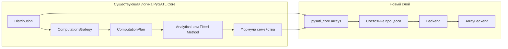

Изменения по существующим компонентам:

| Компонент | Как встраивается архитектура |
|---|---|
| `Distribution.calculate_characteristic` | Нормализует и проверяет публичный вход через пакет `pysatl_core.arrays` |
| `ArrayValidator` | Строит `ValueProfile` и проверяет значение по переданному контракту |
| Публичный `query_method` | Возвращает вызываемую обёртку, применяющую контракт входа |
| Внутреннее разрешение метода | Возвращает исходную функцию без повторной публичной нормализации на каждом шаге |
| `ComputationStrategy` | Продолжает выбирать путь и алгоритм; бекенд не принимает эти решения |
| `ComputationPlan` | Хранит требования и идентичность бекенда, для которого построен маршрут |
| `AnalyticalComputation` | Вызывает пакетные функции `pysatl_core.arrays` |
| `FittedComputationMethod` | Хранит подготовленный алгоритм, связанный с тем же бекендом и устройством |
| Встроенные семейства | Заменяют прямые вызовы числовой библиотеки на функции `arrays.*` |
| `Support.contains` | Строит нативный булев скаляр или маску через функции `arrays.*` |
| `types.py` | Перестаёт определять публичные массивы только через NumPy-типы |
| Переходы характеристик | Используют пакетные функции формы, индексирования и редукций |

Механизм графа характеристик сохраняется. `ComputationStrategy` по-прежнему отвечает за выбор аналитической петли или последовательности переходов. `Backend` отвечает только за исполнение операций выбранного метода.

### Выполнение графового плана

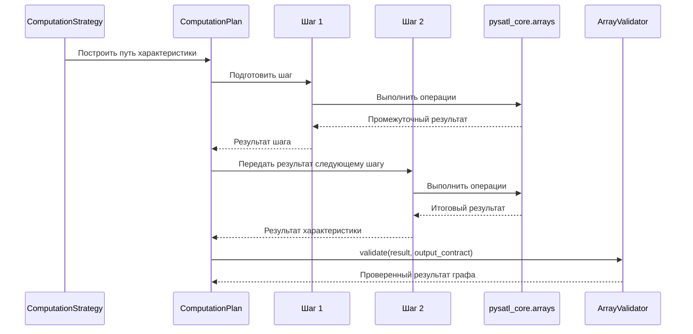

Если итоговый результат графа нарушает выходной контракт, `ComputationPlan` завершает выполнение с `UnexpectedResultError`.

Математический путь и параметры алгоритмов сохраняются. Меняется способ создания данных и выполнения операций.

## Граф характеристик и требования бекенда

Граф остаётся графом характеристик распределения. Его узлы — PDF, CDF, PPF, PMF и другие характеристики; рёбра — способы получить целевую характеристику из исходных. Отдельный граф для каждого бекенда не создаётся.

Новая архитектура добавляет к вычислительному методу декларацию требований. Стратегия использует её как фильтр перед поиском пути.

### Где хранятся требования

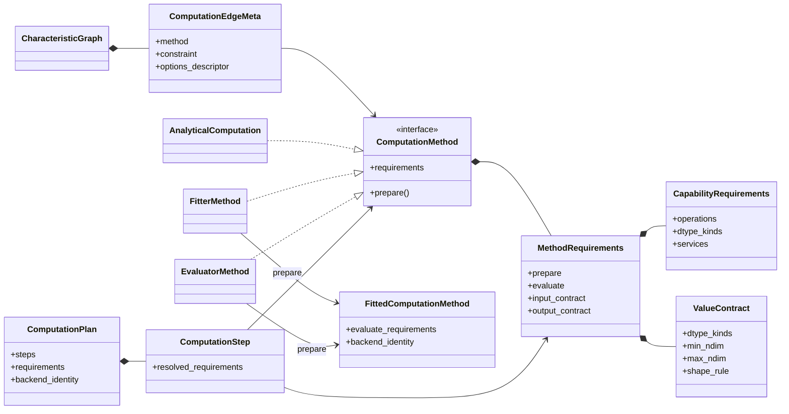

- `AnalyticalComputation`, `FitterMethod` и `EvaluatorMethod` объявляют требования рядом с реализацией метода.
- `FittedComputationMethod` получает требования фазы вычисления и связывается с бекендом, на котором был подготовлен.
- `ComputationEdgeMeta` не копирует требования: ребро уже ссылается на метод.
- `ComputationStep` хранит требования выбранного метода после разрешения параметров.
- `ComputationPlan` объединяет требования шагов и фиксирует идентичность активного бекенда.
- `GraphPrimitiveConstraint` продолжает проверять свойства распределения и не содержит ограничений бекенда.
- `CapabilityRequirements` описывает операции, категории типов и числовые сервисы, необходимые методу. `ArrayContext` проверяет эти требования при построении маршрута.
- `ValueContract` задаёт допустимые категории типов, размерность и правило формы. Стратегия сопоставляет контракты соседних шагов, а `ArrayValidator` проверяет итоговый результат графа.

Перед выполнением план сравнивает сохранённую идентичность с активным бекендом из модуля состояния. Несовпадение приводит к ошибке совместимости; план не переключает бекенд самостоятельно.

### Состав требований метода

| Часть | Содержимое |
|---|---|
| Подготовка | Операции, нужные для построения сеток, таблиц и подготовленного метода |
| Вычисление | Операции, вызываемые готовым методом при обработке входа |
| Входной контракт | `ValueContract` с допустимыми категориями типов, размерностью и формой входа |
| Выходной контракт | `ValueContract` с ожидаемыми типом, размерностью и связью формы результата со входом |
| Возможности | `CapabilityRequirements` с операциями, категориями типов и дополнительными числовыми сервисами |

Разделение подготовки и вычисления важно для `FitterMethod`: подготовка может строить таблицу, а готовый метод — только искать и выбирать значения.

### Построение маршрута

```mermaid
sequenceDiagram
    participant S as ComputationStrategy
    participant G as RegistryView
    participant E as ComputationEdgeMeta
    participant M as ComputationMethod
    participant State as Состояние процесса
    participant C as ArrayContext
    participant P as ComputationPlan

    S->>State: _resolve_backend()
    State-->>S: ArrayContext активного бекенда
    S->>G: Получить рёбра для распределения
    G-->>S: Кандидаты после GraphPrimitiveConstraint

    loop Каждое ребро
        S->>E: Получить method
        E-->>S: ComputationMethod
        S->>M: Получить requirements
        M-->>S: MethodRequirements
        S->>C: supports(requirements.prepare, requirements.evaluate)

        alt Требования к возможностям поддерживаются
            C-->>S: Ребро доступно
        else Возможностей недостаточно
            C-->>S: Причина несовместимости
            S->>S: Исключить ребро
        end
    end

    S->>G: Найти путь по доступным рёбрам
    G-->>S: Совместимый путь
    S->>P: Создать шаги и объединить требования
```

Возможности бекенда используются как фильтр. Выбор математического пути остаётся обязанностью `ComputationStrategy`.

### Правила выбора пути

```mermaid
flowchart TD
    All[Все рёбра графа] --> Domain[Фильтр по свойствам распределения]
    Domain --> Capabilities[Фильтр по требованиям методов]
    Capabilities --> Available{Остались пути?}
    Available -->|нет| Error[Нет совместимого вычислительного пути]
    Available -->|да| Explicit{Метод указан явно?}
    Explicit -->|да| Requested[Проверить запрошенный вариант]
    Explicit -->|нет| ExistingRules[Применить текущие приоритеты и метки]
    Requested --> Plan[ComputationPlan]
    ExistingRules --> Plan
```

Если пользователь явно выбрал несовместимый метод, стратегия возвращает ошибку и не подменяет его другим вариантом. При автоматическом выборе несовместимые рёбра исключаются до применения текущих приоритетов.

### Этапы проверки

| Этап | Что можно проверить |
|---|---|
| Построение пути | Наличие операций, семейства `dtype`, комплексные значения и общие ограничения устройства |
| Подготовка шага | Параметры метода, точный рабочий тип и требования подготовительного алгоритма |
| Выполнение | `ArrayValidator` проверяет итоговый результат графа: форму, устройство, `NaN`, бесконечности и выходной контракт |

Требования всего плана получаются объединением требований его шагов. Операции объединяются, а ограничения входов и выходов должны быть совместимы между соседними шагами.

Параметры вроде допуска или числа итераций не должны менять набор операций. Если параметр выбирает другой алгоритм, этот алгоритм лучше зарегистрировать как отдельный вариант метода с собственными требованиями.

Если совместимый путь не найден, ошибка должна перечислить отклонённые методы и недостающие операции, типы или сервисы. Соответствие декларации реальному коду проверяет записывающий тестовый бекенд: фактически вызванные операции должны входить в объявленный набор требований.

## Граница текущего этапа

В этот этап входят:

- жизненный цикл `Backend`;
- пакетные функции `pysatl_core.arrays` и их делегирование;
- составной интерфейс `ArrayBackend`;
- `ArrayValidator`, `ValueProfile` и проверка контрактов значений;
- правила скаляров, массивов, типов и устройства;
- нормализация публичного входа;
- контрактные ошибки и тесты;
- миграция одной аналитической характеристики для проверки границ.

В этот этап не входят:

- интегрирование и поиск корней;
- интерполяция;
- специальные функции вне обязательного интерфейса массивов;
- генераторы случайных чисел;
- оптимизация параметров;
- адаптеры внешних CPU-библиотек.

Эти области будут добавляться к корневому бекенду отдельными сервисами. Они не должны расширять `ArrayBackend` операциями, не относящимися к массивам.

## Порядок реализации

```mermaid
flowchart LR
    Interfaces[Внутренние интерфейсы] --> State[Состояние процесса]
    State --> Reference[Первая реализация]
    Reference --> PackageAPI[Пакет pysatl_core.arrays]
    PackageAPI --> ContractTests[Контрактные тесты]
    ContractTests --> Normalize[Нормализация входа]
    Normalize --> Vertical[Одна аналитическая характеристика]
    Vertical --> Compare[Сравнение с текущим поведением]
    Compare --> Decision{Контракт подтверждён?}
    Decision -->|нет| Refine[Уточнить интерфейсы]
    Refine --> ContractTests
    Decision -->|да| Migration[Перенос следующих формул]
```

Сначала реализуются интерфейсы, состояние процесса и контрактные тесты. Затем переносится один полный путь, включая временные массивы и проверку выходного контракта графа. Массовая замена вызовов текущей библиотеки начинается только после подтверждения границ на вертикальном сценарии.
