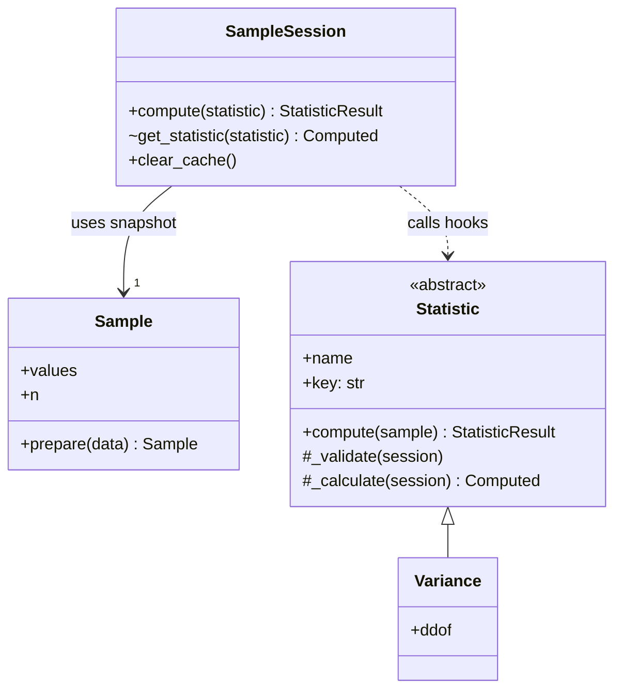
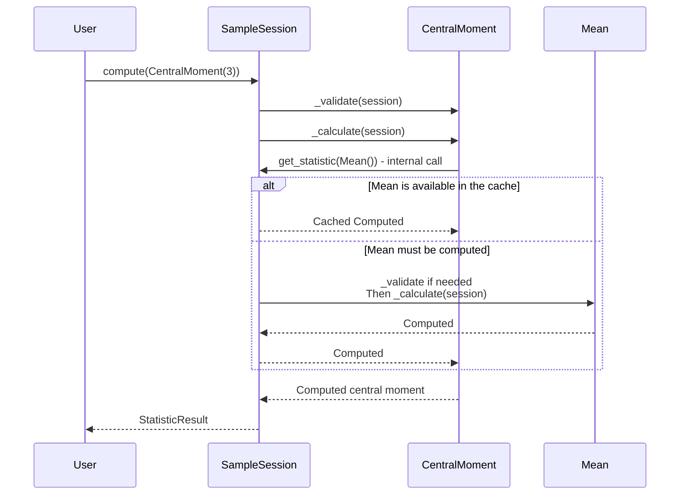
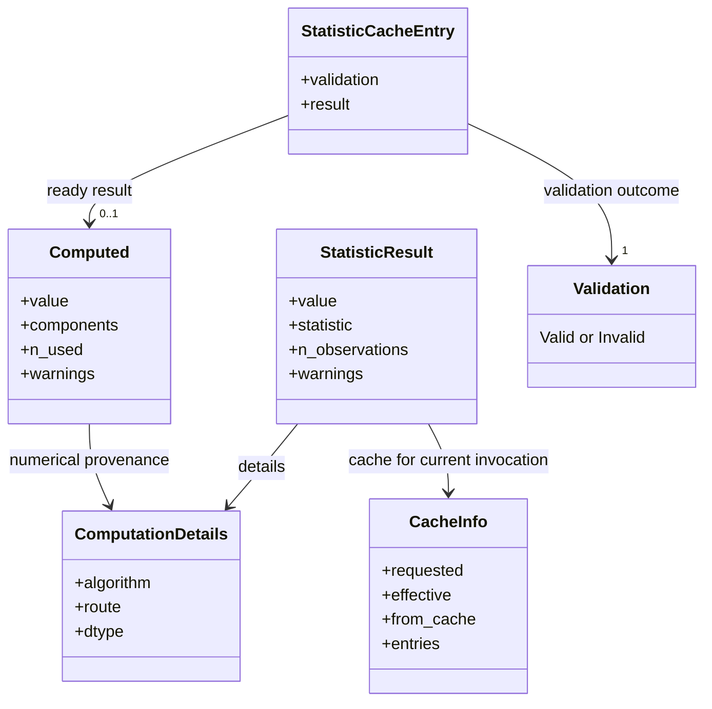

# Sample Statistics Architecture in PySATL Core

Concise architecture proposal · 18 November 2026

**Status: Draft, proposal for discussion.** The APIs and behavior described here define requirements for the system under development.

## Terminology

- **Sample** - a protected snapshot of observations that preserves their order and duplicates.
- **Statistic** - an immutable configuration of an operation on a sample, such as variance with a specified `ddof`.
- **Session (SampleSession)** - an object for repeated and composite computations on a single snapshot.
- **Dependency** - another statistic requested by a statistic through the session's internal `get_statistic` method during the current invocation.
- **Computed** - a numerical result with its mathematical warnings and provenance.
- **StatisticResult** - a public result with its configuration and diagnostics for the current invocation.
- **Statistic key (`Statistic.key: str`)** - a string containing the statistic type and every setting that affects applicability validation or the computed result. For example, the keys for `Variance(ddof=0)` and `Variance(ddof=1)` must differ.
- **Cache entry identifier** - the composite pair `(type(statistic), statistic.key)` used by a session to distinguish entries. This is a separate concept; only `statistic.key` is the statistic's string key.

## Research summary

`Sample.prepare` validates the input and creates a protected sample snapshot. The applicability of a particular statistic to that sample is checked separately. A shared dependency mechanism allows expensive operations, such as sorting, to be reused and applies the same validation rules to built-in and third-party statistics.

## Considered options

| Option | Advantage | Limitation |
|---|---|---|
| Only functions over arrays | Simple one-off calls | Shared dependencies, caching, and diagnostics would need to be managed separately |
| Statistics and cache inside Sample | A concise entry point | The data snapshot acquires computation state and responsibility for the cache lifetime. Sample must remain lightweight; storing statistics and a cache conflicts with this requirement |
| Immutable Sample, Statistic, and a separate session | Independent data and configuration, explicit cache ownership | Requires a shared execution contract |

The third option is selected: one snapshot can be used in different sessions, and one configuration can be applied to different data. Numerical functions remain a lower layer and can be called without result objects. For ordinary use, `statistic.compute(sample)` is sufficient.

## Purpose and scope

The module must compute characteristics of observations without specifying a probability family: the mean, variance, moments, quantiles, order statistics, and L- and TL-statistics. A sample mean and a model's expected value have different inputs and existence conditions, so statistics form a separate module alongside estimation and distributions.

The first version operates on one non-empty sample of finite real-valued observations. Streaming, observation weights, multidimensional input, and concurrent public invocations within one session are out of scope. The i.i.d. assumption is not checked automatically.

## Architecture



- **Sample** owns a protected snapshot of observations. It does not create a session or store statistics or a cache. One snapshot can support independent computations.
- **Statistic[V]** stores an immutable configuration and provides the shared `compute(sample)` method, which always runs without caching. Subclasses define `name`, a string `key` containing the type and all relevant settings, `_validate(session) -> None`, and `_calculate(session) -> Computed[V]`. In both hooks, all requests for other statistics go through `session.get_statistic(...)` within the current invocation and under its cache policy. The shared execution order must not be overridden; statistics do not require registration.
- **SampleSession** manages execution, dependencies, caching, and diagnostics for one Sample. To use caching, the user explicitly creates a session and calls `session.compute(statistic)`. Statistics use the internal `get_statistic` method to obtain dependencies; the session lifetime determines how long entries are retained and when they are released.
- **Numerical kernels** operate on arrays and numbers without sessions or public result objects. Estimators can use them without constructing a `StatisticResult`.

In UML, `~` on `get_statistic` denotes an internal module operation. This method is not a user entry point.

## Data rules and public API

Both public methods, `statistic.compute(sample)` and `session.compute(statistic)`, return `StatisticResult[V]`. The internal `session.get_statistic(statistic)` method returns `Computed[V]`.

`Sample.prepare(data)` creates an independent snapshot of a one-dimensional `float64` sample, preserving order and duplicates. Strings, bool, complex, object arrays, masked arrays, empty input, NaN, and infinities are rejected.

Changing the original array or accessing `values` must not mutate the snapshot; otherwise, cached entries would no longer correspond to the observations. `Sample.prepare(sample)` returns the same object; `sample[1:4]` and even `sample[:]` create a new protected Sample. Empty slices are rejected under the general rules.

An ordinary `statistic.compute(sample) -> StatisticResult` call always runs without caching, including validation and all dependencies. Caching cannot be enabled through `Statistic.compute`. Dependencies use a temporary internal session with caching disabled; repeated ordinary calls do not share entries.

To use caching, the user explicitly creates `session = SampleSession(sample)` and calls `session.compute(statistic, cache=True)`. Passing `cache=False` disables reads and writes for the entire dependency chain. A statistic's configuration does not retain a sample or invocation state.

```python
# Proposed API.
sample = Sample.prepare([1, 2, 3])
direct = Variance(ddof=1).compute(sample)  # Always without caching.
session = SampleSession(sample)
first = session.compute(Variance(ddof=1))
second = session.compute(Variance(ddof=1))
fresh = session.compute(Variance(ddof=1), cache=False)
```

## Interaction sequence

Scenario: an explicitly created SampleSession with caching enabled computes a central moment with a Mean dependency. An ordinary `statistic.compute(sample)` call has caching disabled. A ready root result bypasses hooks and dependency requests.



### Validation and dependencies

**Data preparation → invocation start → applicability validation → calculation → public result → invocation-state cleanup.** A statistic's constructor validates settings, Sample validates data, `_validate` checks applicability to the sample, and `_calculate` and `Computed` check the numerical result. A validation failure prevents the main calculation; no prepared object is passed between the stages.

Both stages request dependencies through `session.get_statistic(statistic) -> Computed`. This is an internal method for interaction between statistics and the session: `_validate` and `_calculate` implementations call it, not users. The user entry points are `statistic.compute(sample)` and `session.compute(statistic)`. The `get_statistic` method is available only within an active invocation and inherits its cache policy, stack, and diagnostics. Calling another statistic's public `compute` would start an independent invocation and lose the shared stack. Without caching, a dependency needed by both stages may be computed more than once.

A cycle is detected when an active identifier `(type(statistic), statistic.key)` repeats, for example `A → B → A`, **before reading the cache**. The identifier remains active from the start of validation until calculation finishes; a set detects repetition, a stack explains the path, and `finally` removes active markers on every exit. Requesting a dependency that has already completed is allowed. A completed-result cache or LRU does not replace this protection: an unfinished calculation has no result yet.

An active-depth limit additionally bounds chains of distinct identifiers; an earlier Python `RecursionError` remains a separate failure. Overlapping public invocations, re-entry, and cache clearing during an active session invocation are rejected immediately. Diagnostics for a result or an expected error are copied before working state is released.

## Cache entry identifier, states, and policy

A session uses the entry identifier `(type(statistic), statistic.key)`: the first element is the statistic's class object, and the second is its string key. `Statistic.key` contains the type designation and every setting that affects validation or the result: `ddof`, orders, levels, trimming, conventions, and algorithm settings. Identical configurations of the same type must produce identical strings; configurations that differ in relevant settings must produce different strings. The sample is not part of the entry identifier because the session is already bound to a single immutable snapshot. Different sessions do not share entries.

- **No entry:** perform validation and calculation.
- **Valid without a result:** validation was retained, but the subsequent calculation failed or the result was not stored because of the memory budget. Reuse validation and perform the calculation.
- **Valid with Computed:** return the ready result without repeating dependency requests.
- **Invalid without a result:** create a fresh exception from the retained reason; do not run the calculation. Invalid combined with a result is forbidden.

A separate validation outcome is needed because validation itself may require expensive dependencies. Invalid retains only expected, deterministic applicability failures, without retaining an exception object or traceback. Numerical failures, programming errors, cycles, and depth-limit failures are excluded, including when they originate in a dependency during validation.

`effective = session.cache_enabled AND invocation_cache` applies to the entire chain. False disables reads and writes, including validation outcomes, but preserves existing entries. True when caching is permanently disabled produces a `session_cache_disabled` warning; an explicit False does not. `get_statistic` has no separate cache argument.

Storage is allocated lazily. The budget accounts for all retained entry identifiers, validation outcomes, values, metadata, and buffers; failing to store an entry does not change the result. Eviction and `clear_cache()` remove whole entries while preserving Sample and the policy. The cache budget does not limit process memory: the snapshot, temporary arrays, and results held by the caller are outside it.

## Results and diagnostics



Computed and StatisticResult contain a value and its description; the public result is assembled from Computed but is not its subclass. An Invalid entry has no result value. The diagram shows relationships between objects rather than the call sequence.

`Computed` contains the value, components, the number of observations used (`n_used`), numerical `details`, and mathematical warnings. The public `StatisticResult` adds the configuration, original sample size, a fresh `CacheInfo`, and warnings from the current invocation. The retained numerical result is separate from the report of how it was used.

A scalar request returns a number; a vector request preserves shape, order, and duplicates, even with one component. Empty requests are rejected. The value must be finite and protected from mutation; a component failure produces an error identifying its position, without returning a partial vector.

`details` explains the actual algorithm and the `direct` / `fallback` route; it does not form a recursive tree of dependency details. Mathematical warnings are retained with validation or a value and remain available on reuse. Policy warnings belong only to the current invocation. Previously returned results and reports do not change after subsequent computations or cache clearing.

`from_cache` means a ready root result was used, `stored` means the numerical result was stored in the current invocation, and `validation_stored` means validation was stored. Using a cached mean in a new variance calculation does not make that variance `from_cache=True`. A ready root result does not generate fictitious dependency events.

**Checks before acceptance:** independence of snapshots and sessions; equal values with caching enabled and disabled; completeness and reproducibility of the string `Statistic.key`; type distinction in the entry identifier; all cache states; cycles in both stages with caching disabled; cleanup after errors; vector shape and warning propagation; numerical stability on boundary inputs; memory accounting and fresh reports. Agreement with a single third-party library is insufficient.
