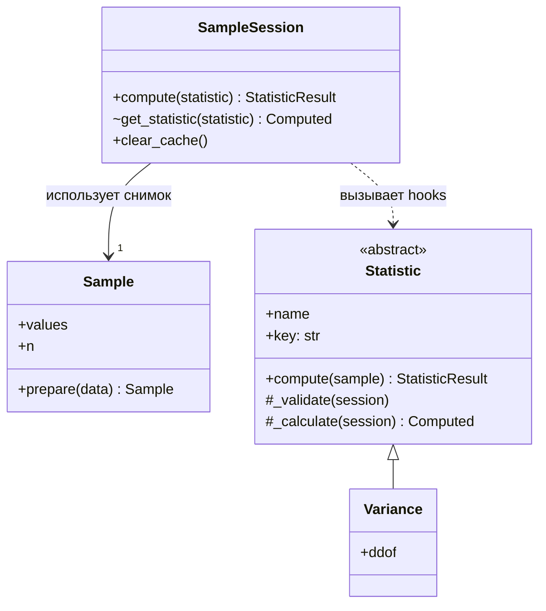
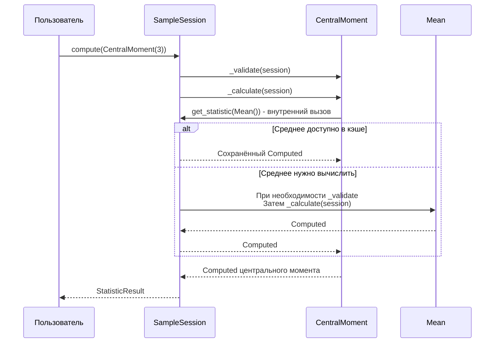
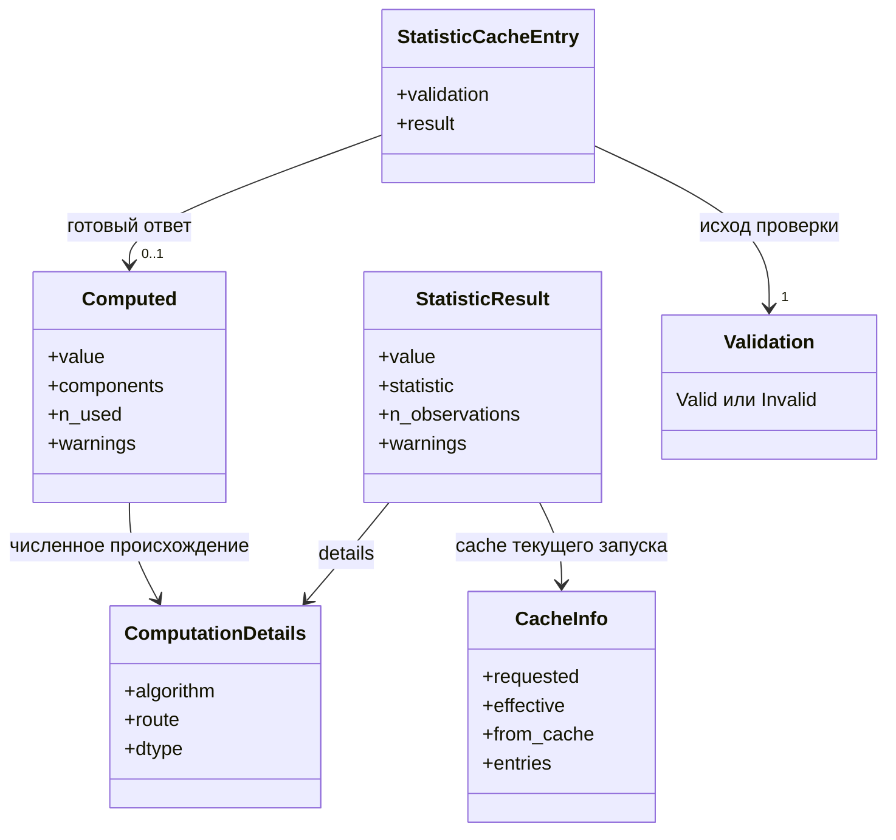

# Архитектура выборочных статистик в PySATL Core

Краткая проектная редакция · 18 ноября 2026

**Статус: Draft, предложение для обсуждения.**  Описанные API и поведение являются требованиями к разрабатываемой системе. 

## Терминология

- **Выборка (Sample)** - защищённый снимок наблюдений с сохранением порядка и повторов.
- **Статистика (Statistic)** - неизменяемая конфигурация операции над выборкой, например дисперсия с заданным `ddof`.
- **Сессия (SampleSession)** - объект повторных и составных расчётов на одном снимке.
- **Зависимость** - другая статистика, запрошенная самой статистикой через внутренний `get_statistic` сессии в текущем запуске.
- **Computed** - численный ответ с его математическими предупреждениями и происхождением.
- **StatisticResult** - публичный результат с конфигурацией и диагностикой текущего запуска.
- **Ключ статистики (`Statistic.key: str`)** - строка, в которой записаны тип статистики и все настройки, влияющие на проверку применимости или результат вычисления. Например, ключи для `Variance(ddof=0)` и `Variance(ddof=1)` должны различаться.
- **Идентификатор записи кэша** - составная пара `(type(statistic), statistic.key)`, по которой сессия различает записи. Это отдельное понятие; строковым ключом статистики является только `statistic.key`.

## Краткие результаты исследования

`Sample.prepare` проверяет входные данные и создаёт защищённый снимок выборки. Применимость конкретной статистики к этой выборке проверяется отдельно. Общий механизм зависимостей позволяет разделять дорогие операции, например сортировку, и одинаково проверять встроенные и сторонние статистики.

## Рассмотренные варианты

| Вариант | Преимущество | Ограничение |
|---|---|---|
| Только функции над массивами | Простой разовый вызов | Общие зависимости, кэш и диагностику пришлось бы организовывать отдельно |
| Статистики и кэш внутри Sample | Короткая точка входа | Снимок данных получает состояние расчётов и время жизни кэша. Sample должен оставаться легковесным; хранение статистик и кэша противоречит этому требованию |
| Неизменяемый Sample, Statistic и отдельная сессия | Независимые данные и конфигурация, явное владение кэшем | Требуется общий контракт исполнения |

Выбран третий вариант: один снимок можно использовать в разных сессиях, одну конфигурацию - на разных данных. Численные функции остаются нижним слоем и пригодны для вызова без объектов результата. Для обычного пользователя достаточно `statistic.compute(sample)`.

## Задача и границы

Модуль должен вычислять характеристики наблюдений без задания вероятностного семейства: среднее, дисперсию, моменты, квантили, порядковые, L- и TL-статистики. Выборочное среднее и математическое ожидание модели имеют разные входы и условия существования, поэтому статистики выделяются в самостоятельный модуль рядом с estimation и distributions.

Первая версия работает с одной непустой конечной вещественной выборкой. Потоковая обработка, веса наблюдений, многомерный ввод и параллельные публичные запуски в одной сессии находятся за её границами. Проверка гипотезы i.i.d. не выполняется автоматически.

## Общая архитектура



- **Sample** владеет защищённым снимком наблюдений. Не создаёт сессию, не хранит статистики и кэш. Один снимок пригоден для независимых расчётов.
- **Statistic[V]** хранит неизменяемую конфигурацию и предоставляет общий `compute(sample)`, всегда без кэша. Наследники задают `name`, строковый `key` с типом и всеми значимыми настройками, `_validate(session) -> None` и `_calculate(session) -> Computed[V]`. В обоих hooks все запросы к другим статистикам выполняются через `session.get_statistic(...)` в текущем запуске с его режимом кэша. Общий порядок выполнения не переопределяется; регистрация статистик не нужна.
- **SampleSession** управляет запуском, зависимостями, кэшем и диагностикой на одном Sample. Для кэширования пользователь явно создаёт сессию и вызывает `session.compute(statistic)`. Внутренний `get_statistic` нужен статистикам для получения зависимостей; время жизни сессии определяет хранение и освобождение записей.
- **Численные ядра** работают с массивами и числами без сессии и публичных результатов. Их можно использовать в оценивателях без создания `StatisticResult`.

В UML знак `~` у `get_statistic` обозначает внутреннюю операцию модуля. Этот метод не является пользовательской точкой входа.

## Правила данных и публичный API

Оба публичных метода, `statistic.compute(sample)` и `session.compute(statistic)`, возвращают `StatisticResult[V]`. Внутренний `session.get_statistic(statistic)` возвращает `Computed[V]`.

`Sample.prepare(data)` создаёт независимый снимок одномерной выборки `float64`, сохраняя порядок и повторы. Строки, bool, complex, object, masked arrays, пустой ввод, NaN и бесконечности отклоняются

Изменение исходного массива или доступ через `values` не должны менять снимок: иначе кэш перестанет соответствовать наблюдениям. `Sample.prepare(sample)` возвращает тот же объект; `sample[1:4]` и даже `sample[:]` создают новый защищённый Sample. Пустой срез отклоняется по общим правилам.

Обычный `statistic.compute(sample) -> StatisticResult` всегда работает без кэша, включая проверки и все зависимости. Включить кэш через `Statistic.compute` нельзя. Для зависимостей используется временная служебная сессия с запрещённым кэшем; повторные обычные вызовы не разделяют записи.

Для работы с кэшем пользователь явно создаёт `session = SampleSession(sample)` и вызывает `session.compute(statistic, cache=True)`. Аргумент `cache=False` отключает чтение и запись для всей цепочки. Конфигурация статистики не удерживает выборку или состояние запуска.

```python
# Проектный API.
sample = Sample.prepare([1, 2, 3])
direct = Variance(ddof=1).compute(sample)  # Всегда без кэша.
session = SampleSession(sample)
first = session.compute(Variance(ddof=1))
second = session.compute(Variance(ddof=1))
fresh = session.compute(Variance(ddof=1), cache=False)
```

## Последовательность взаимодействия

Сценарий: явно созданная SampleSession с разрешённым кэшем рассчитывает центральный момент с зависимостью Mean. При обычном `statistic.compute(sample)` кэш отключён. Готовый корневой ответ не вызывает hooks и зависимости.



### Проверки и зависимости

**Подготовка данных → запуск → проверка применимости → расчёт → публичный результат → очистка состояния запуска.** Конструктор статистики проверяет настройки, Sample - данные, `_validate` - применимость к выборке, `_calculate` и `Computed` - численный ответ. Отказ проверки исключает основной расчёт; подготовленный объект между этапами не передаётся.

Оба этапа запрашивают зависимости через `session.get_statistic(statistic) -> Computed`. Это внутренний метод взаимодействия статистик с сессией: его вызывают реализации `_validate` и `_calculate`, а не пользователи. Пользовательские точки входа - `statistic.compute(sample)` и `session.compute(statistic)`. Метод `get_statistic` доступен только внутри активного запуска и наследует его режим кэша, стек и диагностику. Публичный `compute` другой статистики создал бы независимый запуск и потерял общий стек. Без кэша зависимость, нужная обоим этапам, может вычисляться повторно.

Цикл определяется повтором активного идентификатора `(type(statistic), statistic.key)`, например `A → B → A`, **до чтения кэша**. Идентификатор активен от начала проверки до конца расчёта; множество обнаруживает повтор, стек объясняет путь, `finally` снимает отметки при любом выходе. Повтор уже завершённой зависимости допустим. Кэш готовых значений и LRU эту защиту не заменяют: у незавершённого расчёта ещё нет результата.

Лимит активной глубины дополнительно ограничивает цепочки разных идентификаторов; более ранний `RecursionError` Python остаётся отдельным отказом. Пересекающиеся публичные запуски, повторный вход и очистка активной сессии немедленно отклоняются. Диагностика результата или ожидаемой ошибки копируется до освобождения рабочего состояния.

## Идентификатор записи, состояния и политика кэша

Сессия использует идентификатор записи `(type(statistic), statistic.key)`: первый элемент - объект класса статистики, второй - её строковый ключ. `Statistic.key` содержит обозначение типа и все настройки, влияющие на проверку или ответ: `ddof`, порядки, уровни, усечение, соглашение и настройки алгоритма. Одинаковые конфигурации одного типа должны давать одинаковую строку; различающиеся по значимым настройкам - разные строки. Выборка не входит в идентификатор записи: сессия уже привязана к одному неизменному снимку. Разные сессии не разделяют записи.

- **Нет записи:** выполнить проверку и расчёт.
- **Valid без результата:** проверка сохранена, но последующий расчёт завершился ошибкой либо результат не сохранён из-за бюджета памяти. Переиспользовать проверку, выполнить расчёт.
- **Valid с Computed:** вернуть готовое значение без повторных зависимостей.
- **Invalid без результата:** создать свежее исключение по сохранённой причине; расчёт не запускать. Сочетание Invalid с результатом запрещено.

Отдельный исход проверки нужен, потому что проверка сама может требовать дорогих зависимостей. В Invalid сохраняются только ожидаемые детерминированные отказы применимости, без объекта исключения и traceback. Численный сбой, программная ошибка, цикл и превышение глубины туда не попадают, в том числе если пришли из зависимости во время проверки.

`effective = session.cache_enabled AND cache_запуска` действует на всю цепочку. False запрещает чтение и запись, включая проверки, но сохраняет прежние записи. True при постоянном запрете даёт предупреждение `session_cache_disabled`; явный False его не создаёт. У `get_statistic` нет отдельного аргумента cache.

Хранилище выделяется лениво. Бюджет учитывает все удерживаемые идентификаторы записей, проверки, значения, метаданные и буферы; отказ сохранения не меняет ответ. Вытеснение и `clear_cache()` удаляют записи целиком, сохраняя Sample и политику. Бюджет кэша не ограничивает память процесса: снимок, временные массивы и результаты у пользователя находятся вне него.

## Результат и диагностика



Computed и StatisticResult содержат значение и его описание; публичный результат собирается из Computed, но не является его подклассом. При Invalid поле result записи отсутствует. Схема показывает связи объектов, а не порядок вызовов.

`Computed` содержит значение, компоненты, использованный объём `n_used`, численные `details` и математические warnings. Публичный `StatisticResult` добавляет конфигурацию, исходный размер, свежий `CacheInfo` и предупреждения текущего запуска. Сохранённый численный ответ отделён от отчёта о его использовании.

Скалярный запрос возвращает число, векторный сохраняет форму, порядок и повторы, даже при одной компоненте. Пустой запрос отклоняется. Значение должно быть конечным и защищённым от изменения; отказ компоненты приводит к ошибке с её позицией, без частичного вектора.

`details` объясняет фактический алгоритм и путь `direct` / `fallback`; рекурсивное дерево деталей зависимостей не строится. Математические предупреждения сохраняются с проверкой или значением и доступны при повторном использовании. Предупреждения политики относятся только к текущему запуску. Старые результаты и отчёты не меняются после новых расчётов или очистки.

`from_cache` означает готовый корневой ответ, `stored` - сохранение численного результата сейчас, `validation_stored` - сохранение проверки. Использование сохранённого среднего при новом расчёте дисперсии не делает дисперсию `from_cache=True`. Готовый корень не создаёт фиктивных событий зависимостей.

**Проверить перед принятием:** независимость снимков и сессий; равенство значений при включённом и выключенном кэше; полноту и воспроизводимость строкового `Statistic.key`; различение типов в идентификаторе записи; все состояния кэша; циклы на обоих этапах без кэша; очистку после ошибки; форму векторов и перенос warnings; устойчивость на граничных данных; учёт памяти и свежесть отчётов. Совпадения с одной сторонней библиотекой недостаточно.
