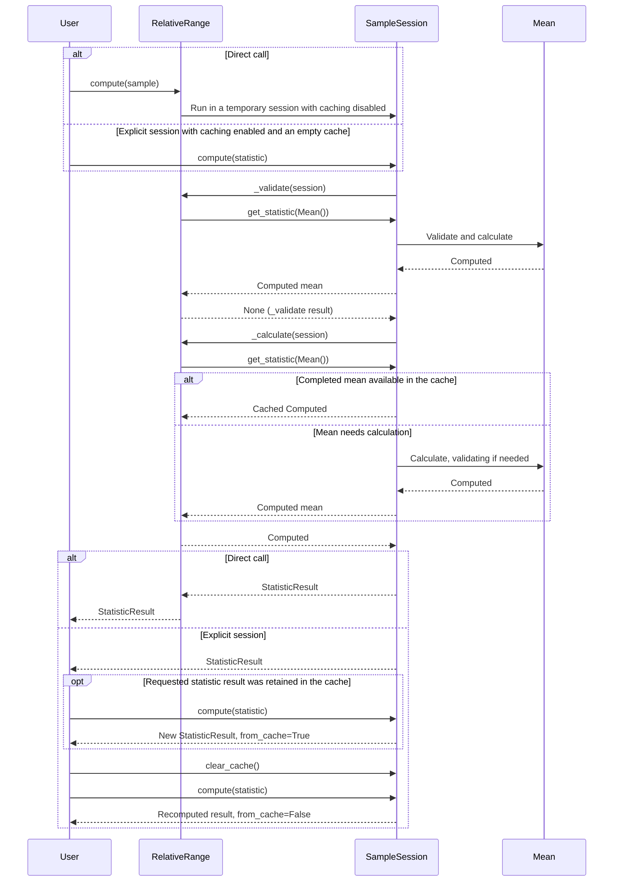
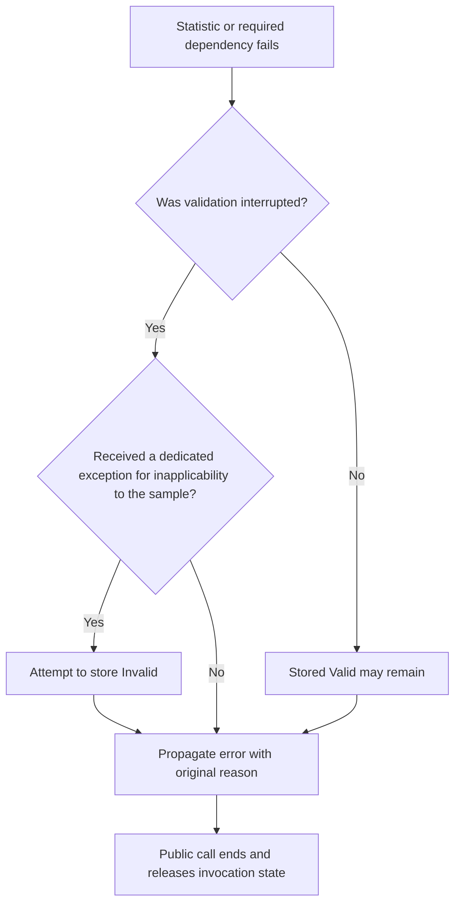

# Sample Statistics Use Cases

Companion to the [statistics RFC](rfc.md) · [Russian version](use-cases.ru.md)

## Computation and repeated requests

The custom statistic `RelativeRange()` divides the sample range by the mean. In `_validate` it requests `Mean()` to check that the mean is positive. In `_calculate` it requests the mean again as the divisor.



A direct call releases its temporary session and always computes dependencies with caching disabled. In an explicit session, a completed result for the statistic requested by the user is retrieved from the cache without repeating validation, calculation, or dependency requests. `clear_cache()` removes results and validation outcomes. Previously returned results remain available.

## Errors and retries

A required dependency's error interrupts the parent's current stage and propagates with its original kind, reason, and phase. The diagram applies to each interrupted statistic in the chain.



- With effective caching and sufficient budget, `Invalid` retains the error kind, reason, and mathematical warnings. For a nested error, it preserves the original phase. A hit on `Invalid` creates a fresh exception with current diagnostics and skips validation and calculation.
- After calculation fails, a stored `Valid` with validation warnings may remain. A hit on `Valid` lets a retry start at `_calculate`. The failed statistic has no completed result. Successful dependency entries may remain. For example, `_validate` succeeds but `_calculate` raises `MemoryError` while allocating a working array; after memory is freed, a retry in the same session reuses the stored `Valid` and completes the calculation successfully.
- Before clearing the stack and working state, an expected error receives `error.warnings` and `error.cache` for the current invocation. The session releases working state on any exception and can accept another call. The cache retains neither the exception object nor its traceback.

## Scenarios

The table gives example messages. Exception type names for applicability and numerical failures are also illustrative.

| Goal and action | What the caller gets | How to proceed |
|---|---|---|
| Compute variance once. Prepare `sample = Sample.prepare([1, 2, 3])` and call `Variance(ddof=1).compute(sample)`. | A `StatisticResult` with value `1.0`. The entire chain runs with caching disabled. | Read `result.value`. |
| Repeat a computation on the same sample. Create `SampleSession(sample)` and call `session.compute(statistic)` twice. | If the requested statistic result was retained in the cache, the second report shows `cache.from_cache=True`. | Pass `cache=False` for a fresh computation that preserves existing entries. Call `session.clear_cache()` between calls to release all entries. |
| Add a custom statistic. Implement an immutable `RelativeRange(Statistic[float])` with `name`, a complete string `key`, `_validate`, and `_calculate` returning `Computed[float]`. | The inherited `compute` works without registration. For `[1, 2, 3]`, the value is `1.0`. | Check both cache modes and verify that a sample with mean `0` is rejected. |
| Prepare a sample with a missing value. Call `Sample.prepare([1, float("nan"), 3])`. | Preparation rejects the input, for example with `ValueError: sample values must be finite`. | Handle the missing value according to the analysis requirements and prepare the sample again. |
| Construct a statistic with an invalid setting. Call `Variance(ddof=-1)`. | The constructor raises `ValueError: ddof must be a nonnegative integer`. | Pass a supported `ddof`. |
| Compute variance with `n=1` and `ddof=1`. | `_validate` raises `InsufficientSampleError: Variance(ddof=1) requires n > 1; got n=1`. Calculation is skipped. | Add observations and prepare a new snapshot, or choose `ddof=0` if it suits the analysis. |
| Test a faulty `RelativeRange` whose `_validate` accepts a zero mean and whose `_calculate` divides Python floats on the sample `[-1, 1]`. | The original programming error, `ZeroDivisionError: float division by zero`. | Check `mean > 0` in `_validate` and raise an applicability error, for example `UndefinedStatisticError: RelativeRange requires a positive mean; got 0.0`. |
| Compute the second raw moment of `[1e308]`. | A numerical failure in `_calculate`: `StatisticComputationError: RawMoment(2) exceeds the float64 range`. | Convert to larger measurement units and compute the moment in the new units squared. |
| Test an extension `A` whose `_validate` requests `Variance(ddof=1)` with `n=1`. | `InsufficientSampleError: Variance(ddof=1) requires n > 1; got n=1`. The error originated in dependency validation. `A._calculate` is skipped and `Invalid` may be stored for `A`. | Prepare a large enough sample and retry. |
| Test an extension `A` whose `_validate` requests `RawMoment(2)` on `[1e308]`. | `StatisticComputationError: RawMoment(2) exceeds the float64 range`. The original phase is `RawMoment._calculate`. `A._calculate` is skipped and no `Invalid` is created for `A`. | Rescale the data or reformulate the extension to compute the quantity it needs without the unrepresentable intermediate moment. |
| Test a chain where `A._validate` requests `B` and `B._calculate` requests `A` again. | `StatisticDependencyCycleError: A → B → A`. The repeated active key is detected before reading the cache. | Remove the dependency back to `A`, for example by extracting the shared calculation into another statistic. |
| Run distinct keys `A(1) → A(2) → A(3) → A(4)` with a limit of three active requests, including the initial request `A(1)`. | `StatisticDependencyLimitError: dependency depth limit 3 exceeded at A(4)`. If Python runs out of stack first, the original `RecursionError` propagates. | Shorten the chain or replace the recursive part with an iterative calculation. |

## Bootstrap

The [Bootstrap overview](../../bootstrap.en.md) describes the method and required components. The calls below illustrate possible usage; the implementation task will determine the concrete API.

```python
sample = Sample.prepare([1, 1, 4])
result = bootstrap(
    Mean(), sample,
    method="nonparametric", replicates=100, rng=42, failure_policy="continue",
)
```

| Goal and action | What the caller gets | How to proceed |
|---|---|---|
| Resample the mean using the call above. | Each attempt computes `Mean()` on a new sample of size three. The empirical probabilities of `1` and `4` are `2/3` and `1/3`. The result reports `attempted=100`, `succeeded=100` and `failed=0`. | Read `result.summary` for the mean and standard error of the replicates. Repeat with the same seed and configuration to reproduce `result.outcomes` in order. |
| Generate parametric replicates of the mean. Fit a Normal model to `[1, 2, 4, 8]` by MLE. After checking `fit.success`, call Bootstrap with `Mean()`, the original prepared sample, `method="parametric"` and `fitted_distribution=fit.distribution`, along with the replicate count, RNG and failure policy. | Each replicate mean uses four observations from the same fitted Normal. Provenance identifies the generating model, sampler and RNG. | Inspect the fit diagnostics if `fit.success` is false. After a successful run, inspect the replicate summary and counters. |
| Refit a Normal MLE on empirical replicates of `[1, 2, 4, 8]`. Pass the configured estimation operation, `method="nonparametric"`, a replicate count, RNG and failure policy. | Each attempt samples four original observations with replacement and fits the same configured model to those observations. A constant replicate can produce a failed fit because its Normal MLE variance is zero. | Inspect the free-parameter estimates on successful attempts and the fit diagnostics on failed attempts. |
| Repeat a parameter fit. Pass the configured Normal MLE operation with the same sample and `method="parametric"`, leaving `fitted_distribution` unset. | One successful fit on the original sample supplies the generating model. Each replicate runs a fresh fit and records the free estimates or the reason for failure. | Read summaries by parameter and check the retained fit diagnostics on failed attempts. |
| Reuse a dependency within a replicate. Run nonparametric Bootstrap on `RelativeRange()` with `cache=True` and a positive sample such as `[1, 2, 3]`. | `_validate` and `_calculate` can reuse `Mean()` within a replicate. Each replicate starts with an empty `SampleSession` cache, even when its observations match a previous replicate. | Inspect the attempt's `StatisticResult.cache`. Compare values against a run with `cache=False` and the same seed. |
| Keep or stop on a failed attempt. Run `RelativeRange()` on nonparametric replicates from `[-1, 3]`. A replicate `[-1, -1]` fails the positive-mean check. | The failed outcome records the attempt index, applicability phase and a reason such as `RelativeRange requires a positive mean`. `continue` runs the remaining attempts. `stop` returns a partial result through that failure. | Read `outcomes` and `failed` before interpreting `summary`. Its mean and standard error describe the successful attempts. |
