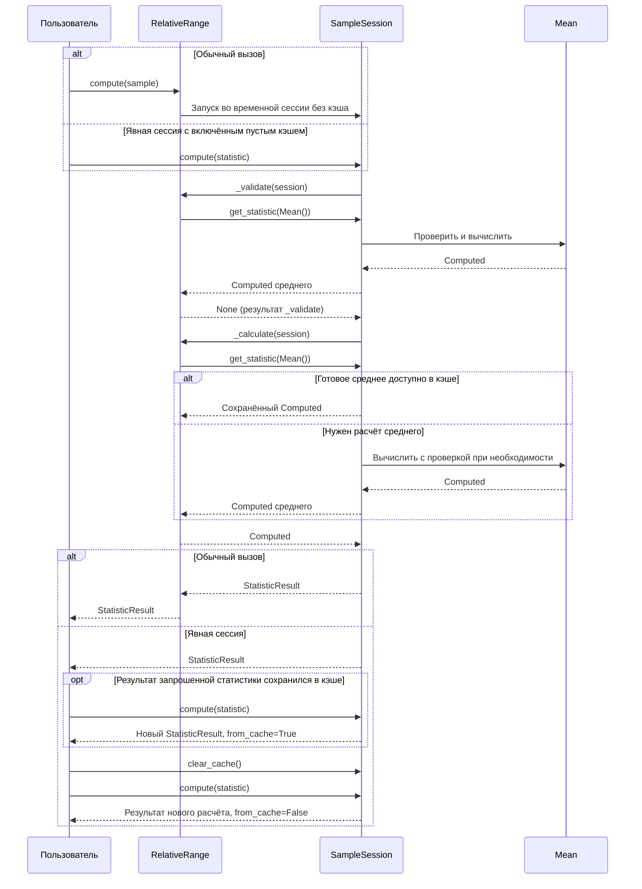
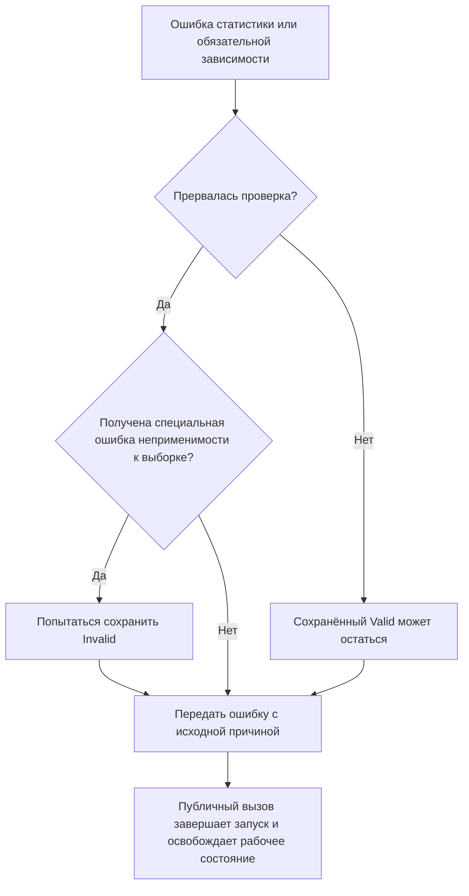

# Сценарии использования выборочных статистик

Приложение к [RFC статистик](rfc.ru.md) · [English version](use-cases.md)

## Вычисление и повторный запрос

Сторонняя статистика `RelativeRange()` делит размах выборки на среднее. В `_validate` она запрашивает `Mean()`, чтобы проверить, что среднее положительно. В `_calculate` она запрашивает его снова как делитель.



Обычный вызов освобождает временную сессию и всегда вычисляет зависимости без кэша. В явной сессии готовый результат запрошенной пользователем статистики берётся из кэша без повторной проверки, расчёта и запросов зависимостей. `clear_cache()` удаляет и результаты, и исходы проверок. Ранее выданные результаты остаются доступны.

## Ошибки и повторный запуск

Ошибка обязательной зависимости прерывает текущий этап родителя и передаётся с исходным видом, причиной и этапом. Схема применяется к каждой прерванной статистике в цепочке.



- При эффективном кэше и достаточном бюджете `Invalid` хранит вид, причину и математические предупреждения. Для вложенной ошибки сохраняется исходный этап. Повтор по `Invalid` создаёт новое исключение со свежей диагностикой, пропуская проверку и расчёт.
- После сбоя расчёта уже сохранённый `Valid` с предупреждениями проверки может остаться. При попадании в `Valid` повтор начинается с `_calculate`. Результат отказавшей статистики отсутствует. Успешные записи зависимостей могут сохраниться. Например, `_validate` прошла, но `_calculate` получила `MemoryError` при выделении рабочего массива; после освобождения памяти повтор в той же сессии использует сохранённый `Valid` и успешно выполняет расчёт.
- До очистки стека и рабочего состояния ожидаемая ошибка получает `error.warnings` и `error.cache` текущего запуска. При любом исключении сессия освобождает рабочее состояние и готова принять новый вызов. Кэш не удерживает объект исключения и traceback.

## Сценарии

Сообщения в таблице приведены как примеры. Названия типов ошибок неприменимости и численного сбоя также иллюстративны.

| Цель и действие | Что получает пользователь | Как продолжить |
|---|---|---|
| Один раз вычислить дисперсию. Подготовить `sample = Sample.prepare([1, 2, 3])` и вызвать `Variance(ddof=1).compute(sample)`. | `StatisticResult` со значением `1.0`. Вся цепочка работает без кэша. | Использовать `result.value`. |
| Повторить вычисление на той же выборке. Создать `SampleSession(sample)` и дважды вызвать `session.compute(statistic)`. | Если результат запрошенной статистики сохранился в кэше, второй отчёт показывает `cache.from_cache=True`. | Передать `cache=False` для свежего расчёта с сохранением существующих записей. Для удаления записей вызвать `session.clear_cache()` между запусками. |
| Добавить свою статистику. Реализовать неизменяемый `RelativeRange(Statistic[float])` с `name`, полным строковым `key`, `_validate` и `_calculate`, возвращающим `Computed[float]`. | Унаследованный `compute` работает без регистрации. Для `[1, 2, 3]` значение равно `1.0`. | Проверить расчёт с кэшем и без него, а также отказ на выборке со средним `0`. |
| Подготовить выборку с пропуском. Вызвать `Sample.prepare([1, float("nan"), 3])`. | Подготовка отклоняет вход, например `ValueError: sample values must be finite`. | Обработать пропуск по правилам анализа и заново подготовить выборку. |
| Создать статистику с неверной настройкой. Вызвать `Variance(ddof=-1)`. | Конструктор выдаёт `ValueError: ddof must be a nonnegative integer`. | Передать допустимый `ddof`. |
| Вычислить дисперсию при `n=1` и `ddof=1`. | `_validate` выдаёт `InsufficientSampleError: Variance(ddof=1) requires n > 1; got n=1`. Расчёт пропускается. | Добавить наблюдения и подготовить новый снимок или выбрать `ddof=0`, если это соответствует задаче. |
| Проверить ошибочную реализацию `RelativeRange`, в которой `_validate` пропускает нулевое среднее, а `_calculate` делит Python-числа на выборке `[-1, 1]`. | Исходная программная ошибка `ZeroDivisionError: float division by zero`. | Добавить проверку `mean > 0` в `_validate` и выдавать ошибку применимости, например `UndefinedStatisticError: RelativeRange requires a positive mean; got 0.0`. |
| Вычислить второй сырой момент для `[1e308]`. | Численный сбой в `_calculate`: `StatisticComputationError: RawMoment(2) exceeds the float64 range`. | Перейти к более крупным единицам измерения и вычислить момент в квадрате новых единиц. |
| Проверить расширение `A`, у которого `_validate` запрашивает `Variance(ddof=1)` при `n=1`. | `InsufficientSampleError: Variance(ddof=1) requires n > 1; got n=1`. Причина возникла при проверке зависимости. `A._calculate` пропускается, допустимо сохранить `Invalid` для `A`. | Подготовить выборку достаточного размера и повторить запрос. |
| Проверить расширение `A`, у которого `_validate` запрашивает `RawMoment(2)` для `[1e308]`. | `StatisticComputationError: RawMoment(2) exceeds the float64 range`. Исходный этап — `RawMoment._calculate`. `A._calculate` пропускается, `Invalid` для `A` НЕ создаётся. | Масштабировать данные или изменить формулу расширения так, чтобы она вычисляла нужную величину без непредставимого промежуточного момента. |
| Проверить цепочку, где `A._validate` запрашивает `B`, а `B._calculate` снова запрашивает `A`. | `StatisticDependencyCycleError: A → B → A`. Повтор активного ключа обнаруживается до чтения кэша. | Удалить обратную зависимость, например вынести общий расчёт в отдельную статистику. |
| Выполнить цепочку разных ключей `A(1) → A(2) → A(3) → A(4)` при лимите в три активных запроса, включая исходный запрос `A(1)`. | `StatisticDependencyLimitError: dependency depth limit 3 exceeded at A(4)`. Если раньше исчерпан стек Python, передаётся исходный `RecursionError`. | Сократить цепочку или заменить рекурсивную часть итеративным расчётом. |

## Bootstrap

Общее описание и необходимые компоненты приведены в [обзоре Bootstrap](../../bootstrap.ru.md). Вызовы ниже иллюстрируют возможный сценарий использования; конкретный API будет выбран в задаче реализации.

```python
sample = Sample.prepare([1, 1, 4])
result = bootstrap(
    Mean(), sample,
    method="nonparametric", replicates=100, rng=42, failure_policy="continue",
)
```

| Цель и действие | Что получает пользователь | Как продолжить |
|---|---|---|
| Пересчитать среднее на повторах с помощью вызова выше. | В каждой попытке `Mean()` вычисляется на новой выборке из трёх наблюдений. Эмпирические вероятности `1` и `4` равны `2/3` и `1/3`. Результат содержит `attempted=100`, `succeeded=100` и `failed=0`. | Взять среднее и стандартную ошибку по повторам из `result.summary`. Повторить вызов с тем же seed и настройками, чтобы воспроизвести порядок и значения `result.outcomes`. |
| Получить параметрические повторы среднего. Подогнать нормальную модель к `[1, 2, 4, 8]` методом MLE. После проверки `fit.success` вызвать Bootstrap с `Mean()`, исходной подготовленной выборкой, `method="parametric"`, `fitted_distribution=fit.distribution`, числом повторов, RNG и политикой отказов. | Среднее каждого повтора вычисляется по четырём наблюдениям из одной подогнанной нормальной модели. Диагностика указывает модель генерации, способ генерации и RNG. | При `fit.success=False` прочитать диагностику подгонки. После успешного запуска проверить сводку повторов и счётчики. |
| Повторить MLE для нормальной модели на эмпирических повторах выборки `[1, 2, 4, 8]`. Передать настроенную операцию оценивания, `method="nonparametric"`, число повторов, RNG и политику отказов. | Каждая попытка выбирает четыре исходных наблюдения с возвращением и заново подгоняет ту же настроенную модель. Постоянный повтор может привести к отказу подгонки, поскольку MLE-оценка дисперсии нормальной модели равна нулю. | Проверить оценки свободных параметров в успешных попытках и диагностику подгонки в неудачных. |
| Повторить подгонку параметров. Передать настроенную операцию MLE для нормальной модели с той же выборкой и `method="parametric"`. `fitted_distribution` оставить незаданным. | Один успешный fit на исходной выборке задаёт модель генерации. На каждом повторе fit выполняется заново, а исход содержит оценки свободных параметров или причину отказа. | Прочитать сводки по параметрам и проверить сохранённую диагностику подгонки в неудачных попытках. |
| Переиспользовать зависимость внутри повтора. Запустить непараметрический Bootstrap для `RelativeRange()` с `cache=True` на положительной выборке, например `[1, 2, 3]`. | `_validate` и `_calculate` могут переиспользовать `Mean()` внутри повтора. У каждого повтора свой `SampleSession` с пустым начальным кэшем, даже когда наблюдения совпали с предыдущим повтором. | Проверить `StatisticResult.cache` для попытки. Сравнить значения с запуском при `cache=False` и том же seed. |
| Продолжить или остановиться после отказа. Запустить непараметрический Bootstrap для `RelativeRange()` на `[-1, 3]`. Повтор `[-1, -1]` нарушает условие положительного среднего. | Исход содержит индекс попытки, этап проверки применимости и причину, например `RelativeRange requires a positive mean`. `continue` выполняет остальные попытки. `stop` возвращает частичный результат, включая отказ. | Перед интерпретацией `summary` проверить `outcomes` и `failed`. Среднее и стандартная ошибка в сводке рассчитаны по успешным попыткам. |
